# OpHUB: Laptop Guide

How to use OpHUB on a laptop or office computer. There is a separate phone guide for site.

## Contents

- [Getting around on a laptop](#getting-around-on-a-laptop)
- **Part 1: Finance**
  - [F1. Overview](#f1-overview)
  - [F2. Projects: the jobs table](#f2-projects-the-jobs-table)
  - [F3. A job's Finance page and Project Admin](#f3-a-jobs-finance-page-and-project-admin)
  - [F4. New projects](#f4-new-projects)
  - [F5. Bill Of Quantities](#f5-bill-of-quantities)
  - [F6. Variations and day works](#f6-variations-and-day-works)
  - [F7. Applications & Certificates](#f7-applications--certificates)
  - [F8. Sales invoices and retention](#f8-sales-invoices-and-retention)
  - [F9. Purchase Invoices and the Finance inbox](#f9-purchase-invoices-and-the-finance-inbox)
  - [F10. Purchase Orders](#f10-purchase-orders)
  - [F11. Statements, Plant Hire and Price Lists](#f11-statements-plant-hire-and-price-lists)
  - [F12. Yard stock](#f12-yard-stock)
  - [F13. Subcontractor POs and CIS](#f13-subcontractor-pos-and-cis)
  - [F14. Labour: operative invoices, wages and the pay run](#f14-labour-operative-invoices-wages-and-the-pay-run)
  - [F15. Reports](#f15-reports)
  - [F16. Directory](#f16-directory)
  - [F17. Settings](#f17-settings)
- **Part 2: Projects as an operative**
  - [O1. Signing in and the one-phone rule](#o1-signing-in-and-the-one-phone-rule)
  - [O2. Your Home page and your projects](#o2-your-home-page-and-your-projects)
  - [O3. Check in and out with GPS](#o3-check-in-and-out-with-gps)
  - [O4. Schedule of Works and photos](#o4-schedule-of-works-and-photos)
  - [O5. H&S: RAMS, COSHH, talks and briefings](#o5-hs-rams-coshh-talks-and-briefings)
  - [O6. Permits, HAVS, PPE and incidents](#o6-permits-havs-ppe-and-incidents)
  - [O7. Snags and variations](#o7-snags-and-variations)
  - [O8. Materials](#o8-materials)
  - [O9. Drawings](#o9-drawings)
  - [O10. Messages and Inbox](#o10-messages-and-inbox)
  - [O11. Expenses](#o11-expenses)
  - [O12. My Dashboard and Settings](#o12-my-dashboard-and-settings)
- **Part 3: Projects as a project manager**
  - [P1. Your Home page](#p1-your-home-page)
  - [P2. Making a project](#p2-making-a-project)
  - [P3. Site location and check-in area](#p3-site-location-and-check-in-area)
  - [P4. Putting the team on a job](#p4-putting-the-team-on-a-job)
  - [P5. Project Settings](#p5-project-settings)
  - [P6. Client info and client POs](#p6-client-info-and-client-pos)
  - [P7. Schedule of Works](#p7-schedule-of-works)
  - [P8. RAMS](#p8-rams)
  - [P9. COSHH](#p9-coshh)
  - [P10. Toolbox talks and daily briefings](#p10-toolbox-talks-and-daily-briefings)
  - [P11. Permits, inductions and inspections](#p11-permits-inductions-and-inspections)
  - [P12. Incidents, HAVS and PPE](#p12-incidents-havs-and-ppe)
  - [P13. Materials and orders](#p13-materials-and-orders)
  - [P14. Material PO's and plant hire](#p14-material-pos-and-plant-hire)
  - [P15. Subcontract orders](#p15-subcontract-orders)
  - [P16. Deliveries](#p16-deliveries)
  - [P17. Drawings and documents](#p17-drawings-and-documents)
  - [P18. Calendar](#p18-calendar)
  - [P19. The HUB and To Book](#p19-the-hub-and-to-book)
  - [P20. Reports and surveys](#p20-reports-and-surveys)
  - [P21. Snags, day works and inspections](#p21-snags-day-works-and-inspections)
  - [P22. Variations](#p22-variations)
  - [P23. The Price tile](#p23-the-price-tile)
  - [P24. Handover (O&M)](#p24-handover-om)
  - [P25. Quotes](#p25-quotes)
  - [P26. Dashboards](#p26-dashboards)
  - [P27. Admin: users, invites and phones](#p27-admin-users-invites-and-phones)
  - [P28. Admin › Roles › What Each Role Can Do](#p28-admin--roles--what-each-role-can-do)

---

## Getting around on a laptop

On a laptop, the menu sits down the left-hand side. It's always there.

1. **Top:** your company's name and logo. Click it to go Home.
2. **Search** (or press **Ctrl K**) finds reports, drawings, materials, to-dos and snags.
3. **Managers' menu**, under three headings:
   - **WORK:** **Projects** (▾ opens **On Site Now**, **Sites Map**, **Reports & Surveys**), **Quotes**, **Deliveries** (▾ **Delivery Schedule**, **Yard & Plant**) and **Calendar**.
   - **TEAM:** **Hub** and **Dashboards** (▾ **Company**, **Operatives**).
   - **OFFICE:** **Finance**, then **HR**.
4. **Operatives' menu:** **Home**, **My projects**, **Inbox**, **My Dashboard** and **Settings**.
5. **THIS PROJECT** appears when you're inside a job: **Project Home**, **Schedule of Works**, **Health & Safety**, **Check In**, **Inbox**, and for managers **Price**, **Finance** and **Project Settings**.
6. **Admin** is at the bottom, above your name and **Sign out**.

The trail at the top of each page shows where you are. Click any part of it to go back.

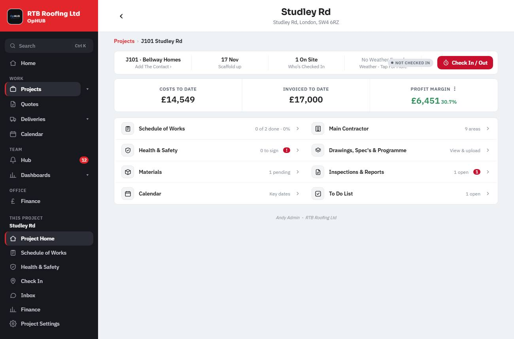

---

# Part 1: Finance

Finance is where the money lives. Click **Finance** in the left-hand menu (or the **OpHUB Finance** tile on Home). The tabs along the top are **Overview**, **Projects**, **Sales**, **Purchases**, **Subcontractors & Labour**, **Reports**, **Directory** and **Settings**.

> **Finance is on trial for RTB.** While it is, nothing is sent from Finance: no emails, no Xero, no pushes to PMs, and no inbox processing. Overview shows a 🔒 line saying so. The test company "Sandbox Roofing" isn't affected.

You only see Finance if it's switched on for you (Admin › Users › **Finance**). A role without **Finance – Edit** sees **View Only**.

## F1. Overview

**What it's for:** the company's money at a glance.

1. Click **Finance**. You land on **Overview**.
2. Read the six figures: **Live Contract Value** (with the number of live jobs under it), **Still To Invoice**, **Owed To You**, **Overdue**, **Due Out To Suppliers** and **Retention Held By Clients**.
3. Click a figure to open the list behind it.
4. Each figure's **⋯** changes what it covers. The tiles stay in their places. Contract Value and Still To Invoice: **Live**, **Upcoming**, **Closed** or **All Jobs**, **By Start Date** or **By Client**. Owed To You: **Due In The Next 30** or **60 Days**, **By Due Date** or **By Client**. Overdue: **Over 30**, **60** or **90 Days Late**, or **By Client**. Due Out To Suppliers: **Due In The Next 30** or **60 Days**, **Past Their Due Date**, **By Due Date** or **By Supplier**. Retention: **Live** or **Closed Jobs**, or **By Client**. The tile's name says what it's showing. Your choices are kept for you on the laptop and the phone.
5. Work down **Needs Attention**. Click a line to go straight to where it's dealt with.

**Due Out To Suppliers** is what you owe suppliers (materials, plant, scaffold, skips) on invoices not paid yet, including VAT, whether approved or not. The note under it says how much still **Needs Approval**. Subcontractors and labour aren't in it.

**What This Does In Projects:** finance users see a money strip on each project's home page in Projects: costs to date, invoiced and profit margin.

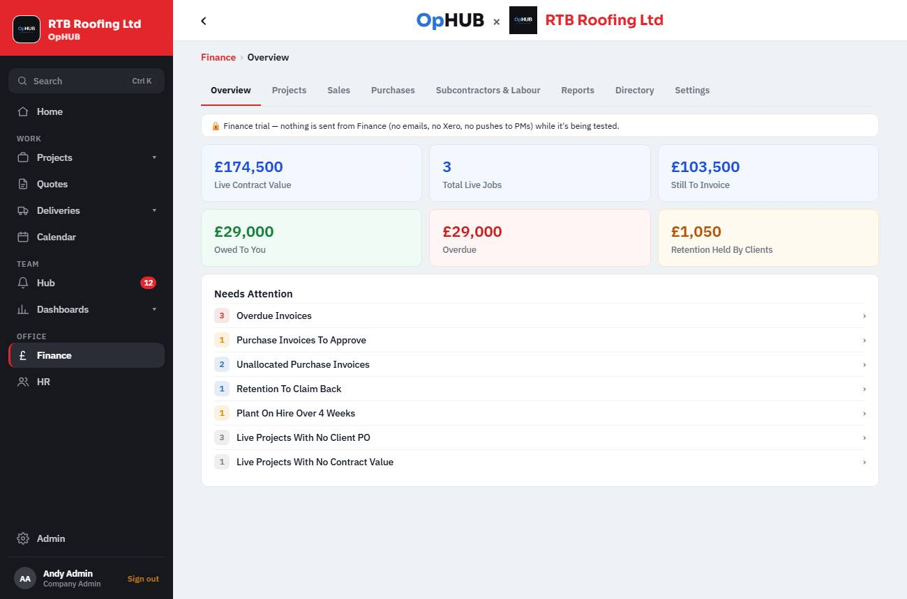

## F2. Projects: the jobs table

**What it's for:** every job with its client, client PO, PM, value, invoiced, owed and overdue.

1. Click **Projects**. The **Status** column starts on Live.
2. Click a heading to sort. Type in the box under a heading to filter.
3. **Project** also finds the client, PO and postcode. **Value** takes things like ">50k".
4. Click a job to open its Finance page.

**What This Does In Projects:** this is the same list of jobs as Projects. A job closed in Projects drops out of the pickers for new invoices, POs and yard stock.

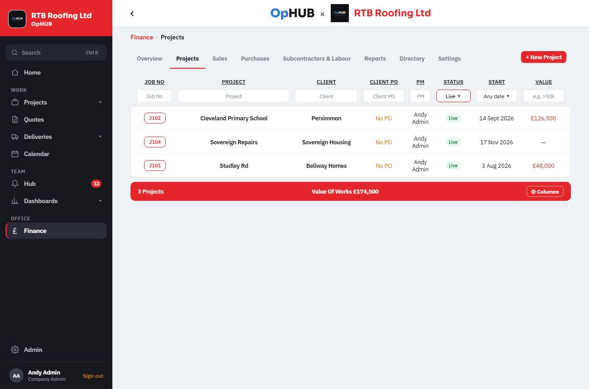

## F3. A job's Finance page and Project Admin

**What it's for:** everything about one job's money.

1. Open a job. Its tabs are **Overview**, **Sales**, **Purchases**, **Subcontractors & Labour**, **Bill Of Quantities** (or **Variations** on an invoice job, **Live Jobs** on a repair contract), **Documents** and **Project Admin**.
2. **Overview** shows contract value, variations, day works, applied, certified, invoiced, costs and forecast profit. **Needs Attention** is at the foot.
3. Click **+ New ▾** to add an invoice, application, purchase order, purchase invoice, plant hire or subcontractor order.
4. **Project Admin** holds the project details, **Project Financials** (contract value, retention, payment terms, billing), client POs (**+ Add Client PO**) and **📁 Link Estimating Folder**.
5. **Documents** shows the job's OneDrive folder, as it is in OneDrive.
6. Click **Go To Project** to open the same job in Projects.

**What This Does In Projects:** changing the name, address or status in Project Admin changes the job in Projects. A client set up here is locked in Projects. Client POs added in Projects show here. **🗑 Delete this project** offers to close the job instead if it has any finance on it.

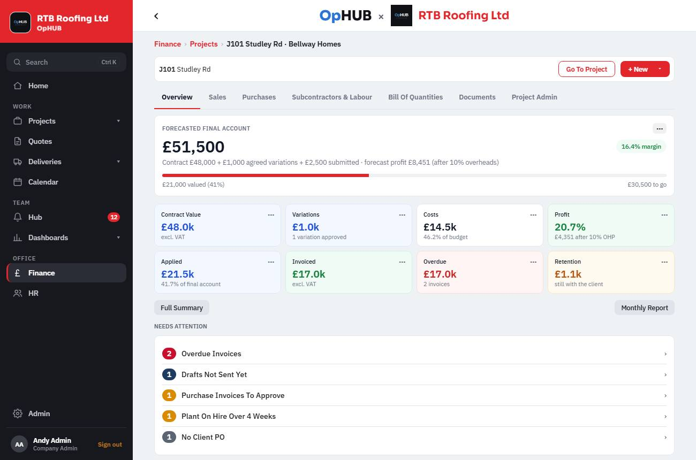
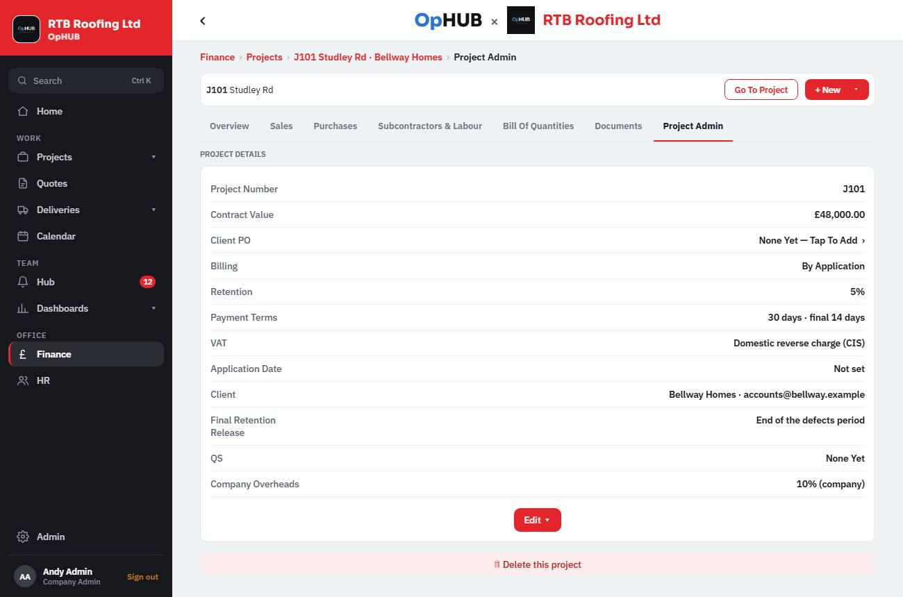

## F4. New projects

**What it's for:** setting a job up from Finance.

1. Click **Projects**, then **+ New Project** at the end of the tab row.
2. **While Finance is on trial, RTB can't make projects here.** You'll see a note and **Go to Projects**. Set the job up in Projects (Part 3, P2). Its Finance page is then ready here.
3. When it's open, fill in the project number, name, address, status, PM and **Payment Procedure** (**Invoice** or **Application for payment**).
4. Add the contract value, client and **Client PO number**. Click **📎 Add PO files** for the PO copy.
5. Click **Create project**.

**What This Does In Projects:** a project made here is also made in Projects, with its client PO.

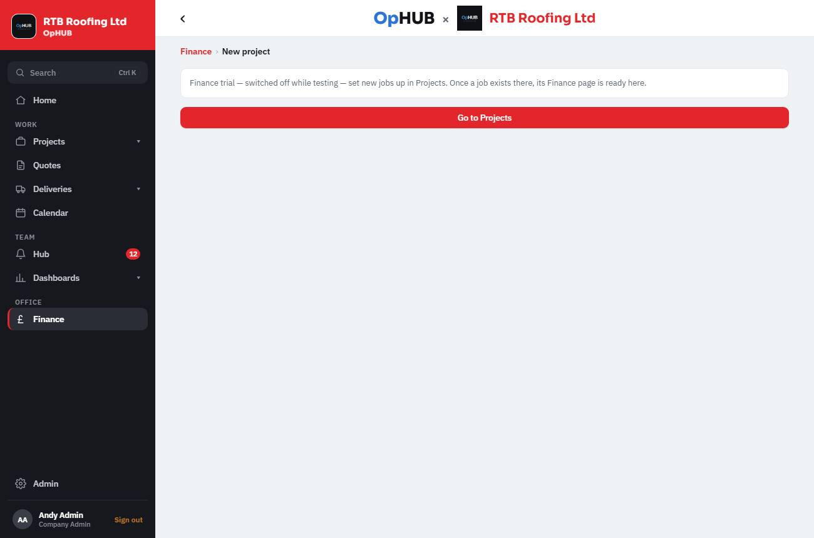

## F5. Bill Of Quantities

**What it's for:** the priced breakdown you apply for payment against.

1. Open a job. Click **Bill Of Quantities**. The inner tabs are **BoQ**, **Variations**, **Plots** and (on multi-site jobs) **Costs By Plot**.
2. Click **+ Add Works** and choose **Section** or **Item**. Type the ref, description, qty and rate, or a lump sum.
3. To bring a breakdown in, click **Import / Export**, then **Import a breakdown (Excel, CSV or PDF)**. Check it and click **Use this breakdown**.
4. Use **Budget cost tools** to set a margin or mark-up on all lines, or ticked lines.
5. Click **Save Bill of Quantities**. It also saves by itself.
6. Click **Publish to Application for Payment** to start an application.

**What This Does In Projects:** click **Import / Export**, then **Send to the operatives' schedule**. It adds the Bill's sections and items to the job's Schedule of Works, without prices. It never deletes tasks or touches progress. The site team's progress then shows on your applications.

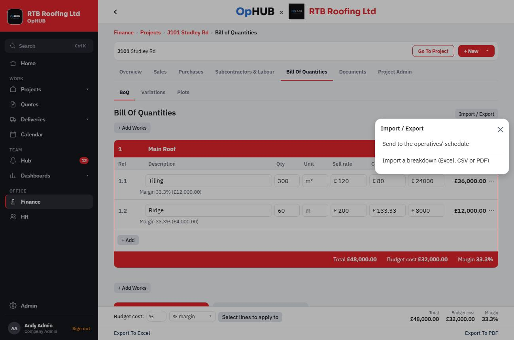

## F6. Variations and day works

**What it's for:** the job's variations register and day works.

1. Open the job's **Bill Of Quantities**, then **Variations**. **Day Works** is beside it.
2. Click **+ Variation** to add one by hand. Fill in the title, who instructed it, the value issued and the approved value.
3. Use the tabs **All**, **Issued**, **Approved** and **Rejected**.
4. Approve one with its approved value. It goes onto the next application.
5. Click **+ Schedule of Works** on a variation to put it on the site's schedule.

**What This Does In Projects:** variations raised on site come in here by themselves when you open this tab. The client stage set in Projects decides the status. A variation already on the site's schedule shows **✓ On the schedule**. Day works recorded in Projects come in by themselves for you to value.

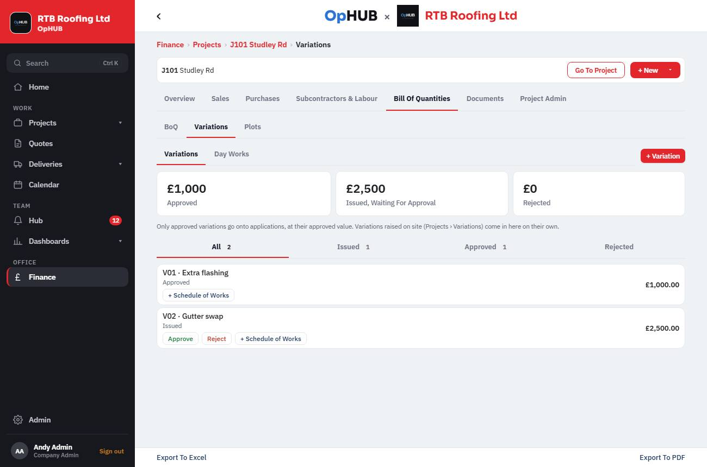

## F7. Applications & Certificates

**What it's for:** applying for payment, then recording the client's certificate.

1. Click **Sales**, then **Applications & Certificates**, then **+ New Application**. Type a few letters of the job in the **Project** box at the top and click it. Or use **+ New ▾** on the job.
   A job with no Bill of Quantities starts with one line, **Contract Works**, at its contract value. It isn't sent to the operatives' schedule.
2. Fill in each line's % (or £) this time. **Bulk Edit ▾** has **Set All To 100%**.
3. Add **+ Variation Line** or **+ Add Day Work** if needed.
4. Click **Apply For Payment**. It locks.
5. When the client certifies, open **Client's Certificate**. Use **Certified As Applied**, or type their figures. Tick **This Is A Pay-Less Notice** if it is one.
6. Click **Save Certificate**, then **Raise Invoice**.

In the list, the **Type** column says **Application** or **Certificate**. Its drop-down under the heading shows just one kind.

**What This Does In Projects:** each line shows the site's progress (for example "Site 40%"). Click **Use site progress** to fill lines from the Schedule of Works. Application dates show on the Projects calendars as **💷 Application due**. Emailing an application is off during the trial.

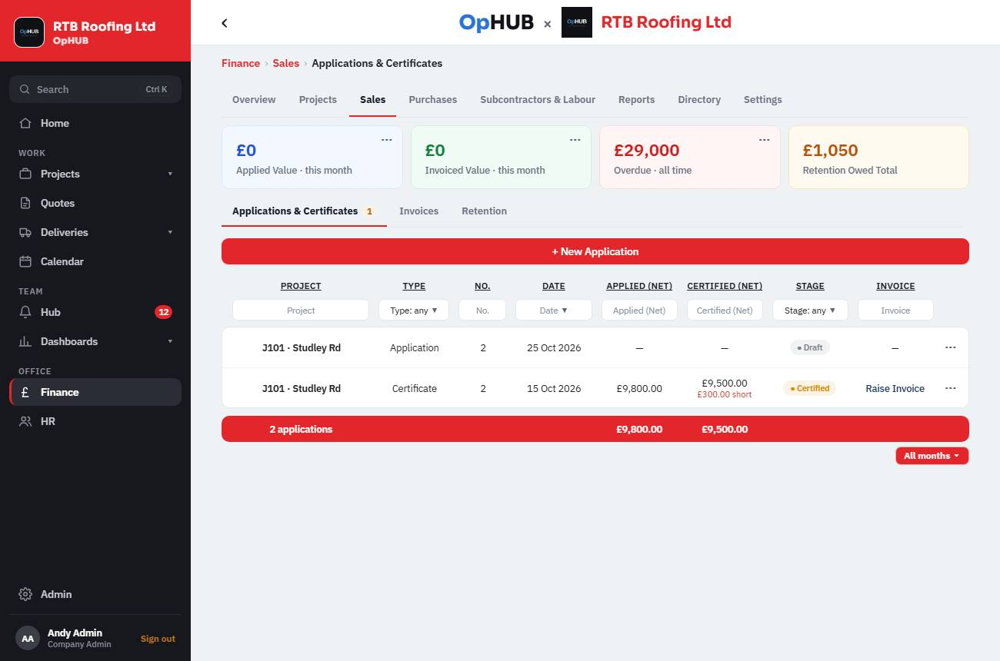

## F8. Sales invoices and retention

**What it's for:** invoicing the client, recording payments, and tracking retention.

1. Click **Sales**, then **Invoices**, then **+ New Invoice**. Or use **+ New ▾** on the job.
2. Check **Bill to** and the dates. Click **+ Add line** for each line. Set the VAT.
3. Click **Save Draft**, then **Issue Invoice**.
4. Click **Export PDF**. (**Email Invoice** is off during the trial.)
5. When paid, click **+ Record payment**.
6. Click **Retention** to see what's held and when it's due back.

**What This Does In Projects:** the job's client PO goes on the invoice. The practical completion date and defects period set in Projects › Handover give the retention release dates.

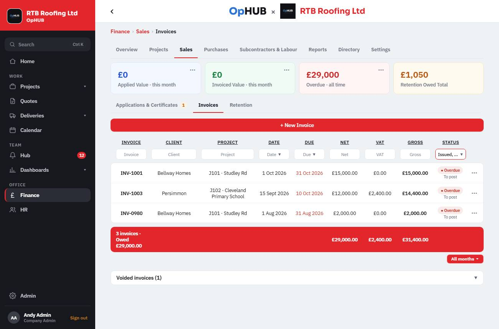

## F9. Purchase Invoices and the Finance inbox

**What it's for:** supplier invoices: getting them in, checking them and paying them.

1. Click **Purchases**. It opens on **Purchase Invoices**.
2. Use the tabs: **Received**, **With A PM**, **Needs Checking**, **Approved** and **All**.
3. **Received** holds invoices emailed to your Finance inbox and ones you've added. To add one, click **Add Invoices** and drop the files on the page.
4. Open one. Check what was read. Choose the job (and PO). Click **🏷 Code each line** to split it across jobs and cost types.
5. Click **Save**, **Query To PM**, **Query Supplier** or **Approve Invoice**.
6. Once paid, click **Mark Paid Today** (or **Mark Paid** in the row's actions).

While Finance is on trial, the app doesn't read or file inbox emails by itself.

**What This Does In Projects:** the cost lands on the job and shows in its money strip. **Query To PM** sends the PM a question in their HUB; their reply comes back here. **Send To PM** asks a PM to book an invoice to a job from their **To Book** page (off during the trial). If site reported a delivery problem, that PO's invoices go on hold.

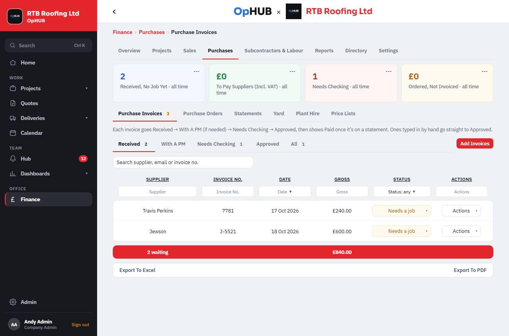

## F10. Purchase Orders

**What it's for:** orders to suppliers, and what's been invoiced against them.

1. Click **Purchases**, then **Purchase Orders**.
2. Click **+ New PO** at the end of the tab row.
3. Choose the **Supplier**. Click **+ Add Line** for each item. Set the job, cost code, VAT and Disc % per line.
4. Choose delivery or collection and the date.
5. Click **Raise PO**. Use **⬇ Export PDF**. (**✉ Email PO** is off during the trial.)
6. On a saved PO: **+ Add Invoice**, **Remove Ticked Lines**, **Mark Fully Invoiced** or **Reopen PO**. **📥 Upload Quote** attaches the supplier's quote.

**What This Does In Projects:** a PO raised here shows on the job's Materials as **Ordered By The Office**, with no prices, and its date shows on the job's calendar. POs raised from a job's Materials requests appear here. A sent PO is locked in Projects. Cancel it here and its requests show as cancelled in Projects. When site saves a goods received note, the PO's lines show as received.

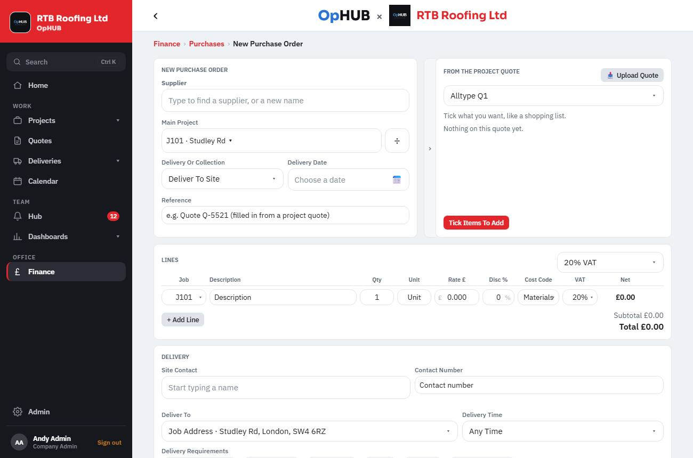

## F11. Statements, Plant Hire and Price Lists

**What it's for:** checking supplier statements, plant on hire, and supplier prices.

1. **Statements:** click **⬆ Upload Statement** (PDF, Excel or CSV). Each line is matched to your invoices.
2. Fix a match by hand, then click **Mark Reconciled**. **Add Missing Invoice** adds one you don't have.
3. **Plant Hire:** click **+ Plant Hire**. Fill in the item, supplier, rate per day or week, and on and off hire dates.
4. **Price Lists:** click a supplier to see everything priced from them.

**What This Does In Projects:** plant a PM puts on hire in Projects appears in **Plant Hire** with no rate. Add the rate, and it's costed to the job.

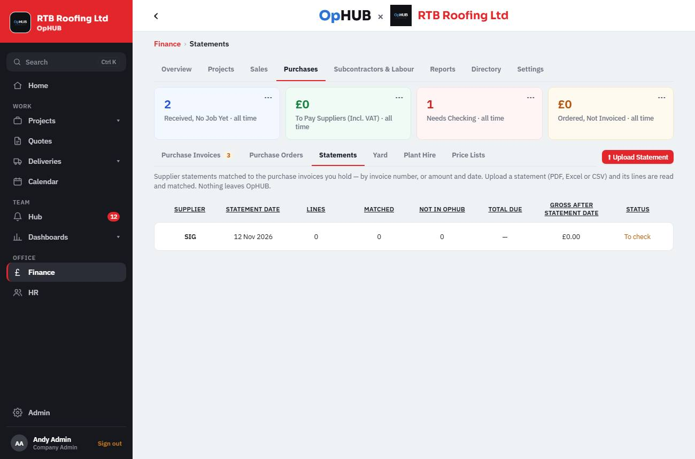

## F12. Yard stock

**What it's for:** stock in the yard, with rates, and its value.

1. Click **Purchases**, then **Yard**.
2. Click **+ New Item** to add a stock item.
3. Click **⬇ Book In** for a new delivery or a return from a job.
4. Click **⬆ Book Out** to send stock to a job.
5. Click **Stock Take** to count what's there.

**What This Does In Projects:** stock booked out to a job is costed to that job. When a PM fills a request with **🏗 Yard Stock** in Projects, the cost lands on the job here too. Drivers and PMs can book stock into the yard from Projects.

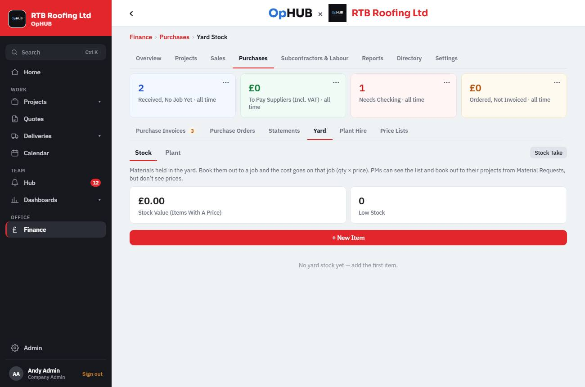

## F13. Subcontractor POs and CIS

**What it's for:** orders to subcontractors, their applications, and CIS.

1. Click **Subcontractors & Labour**, then **Subcontractor POs**.
2. Click **+ Subcontractor PO**. Fill in **Subcontractor**, **Work**, **Order value £**, **Retention %**, **CIS rate** and **UTR**.
3. Tick **Add to the project's Price file for the PM (an issued price sheet)** if the PM should book against it.
4. When they apply, open the order. Click **+ Record an application**, then **Certify**.
5. Click **Pay them**, then **Mark paid today**. The CIS payment is recorded first.
6. Click **CIS** to see the month's CIS payments.

**What This Does In Projects:** subcontract orders raised by PMs in Projects land here, marked **Finance To Add The Value**. The ticked box puts the order into the job's Price tile as an issued price sheet.

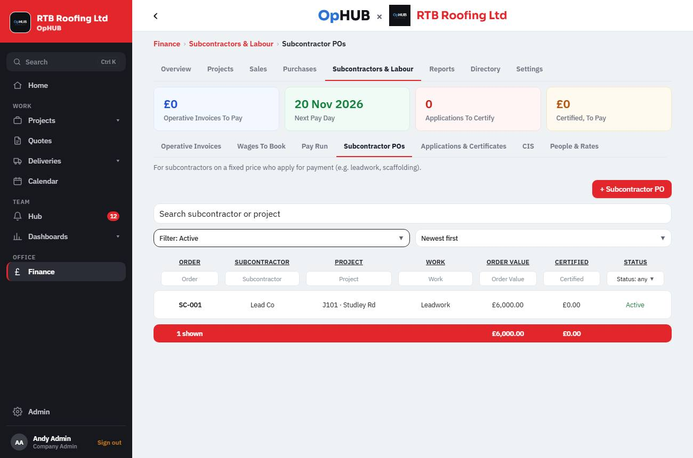

## F14. Labour: operative invoices, wages and the pay run

**What it's for:** paying operatives, and costing labour to jobs.

1. Click **Subcontractors & Labour**, then **Operative Invoices**. Click **+ Operative invoice**.
2. Pick the person. Add their invoice number, date and week. Add the amount for each job (**+ Another job**) and any materials.
3. Click **Save — ready for the pay run**.
4. **Pay Run** shows what's due on the next pay day.
5. **Wages To Book**: click **Bring in PAYE wages** for a week. It uses check-ins and day rates.
6. **People & Rates** opens the labour list in the Directory, with day rates and CIS.

**What This Does In Projects:** PAYE staff's check-ins in Projects become day costs on each job, at their day rate. Operative invoices cost labour to each job. Wages then wait for the PM to book them against the job's Price tile. (Sending wages to PMs is off while Finance is on trial.)

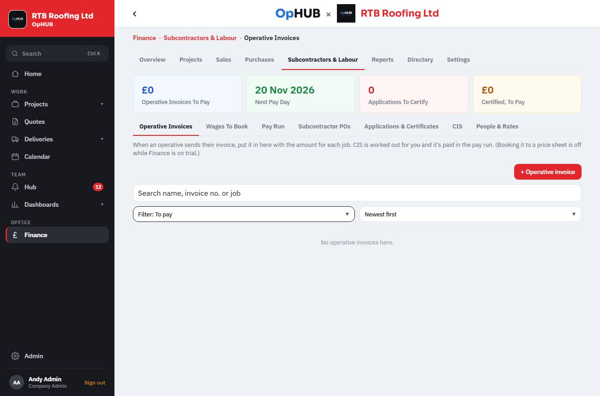

## F15. Reports

**What it's for:** reports across jobs, saved as Excel or PDF.

1. Click **Reports**. Pick one, for example **Cost value reconciliation (CVR)**, **Money due**, **Aged debtors**, **Labour by person**, **CIS payments** or **VAT listing**.
2. Choose the **Projects** and the dates (**From**, **To**).
3. Read the table. Download it as Excel or PDF.
4. To save it automatically, set **How often** and **Which day**, then **Save** (or **Save and run now**).

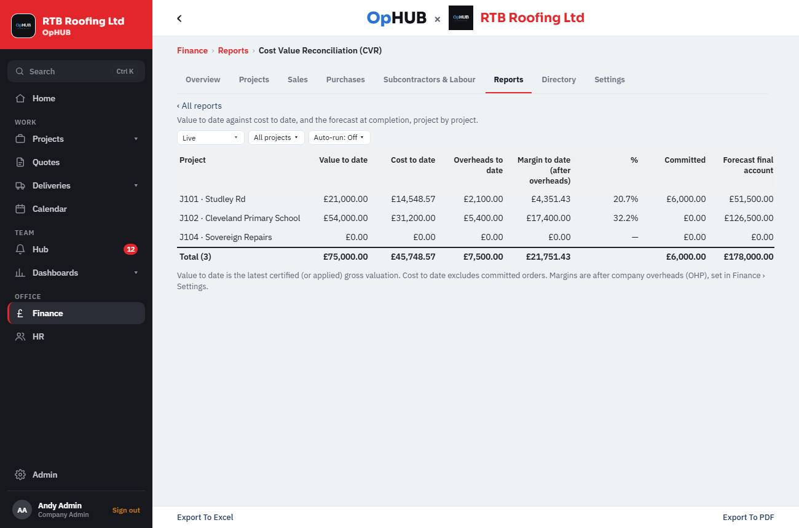

## F16. Directory

**What it's for:** your clients, suppliers and labour, and their details.

1. Click **Directory**. The tabs are **Clients**, **Estimating**, **Suppliers** and **Labour (CIS)**.
2. Open a client or supplier to set contact details, VAT, payment terms and default cost code.
3. On **Labour (CIS)**, click **+ Add a person**, or open one. Set their UTR, CIS rate and day rate.
4. A subcontractor's sign-up form can be added with **Add to directory**.

**What This Does In Projects:** clients here are suggested when a PM types the client on a new project. A supplier can be linked to the Projects supplier list. Day rates here cost check-ins on jobs.

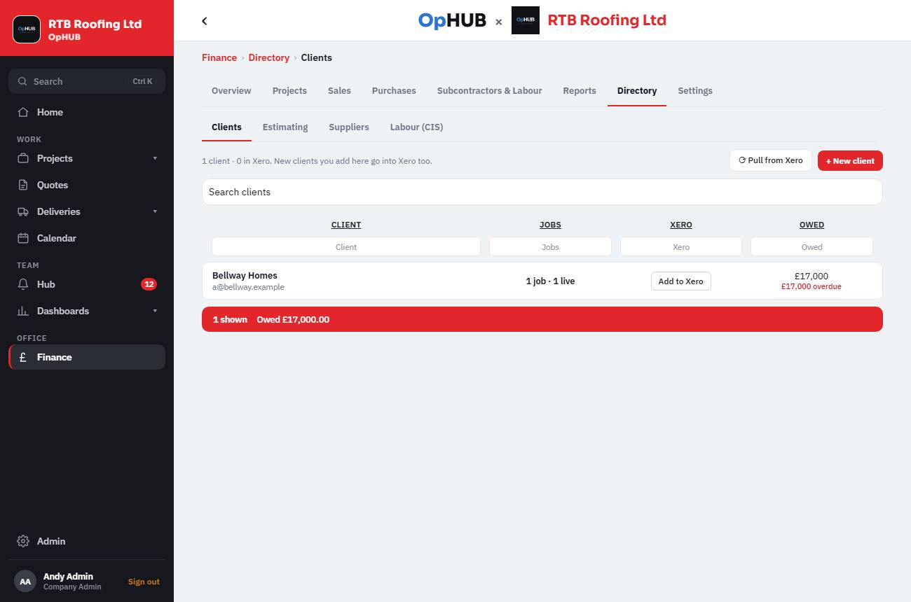

## F17. Settings

**What it's for:** how Finance numbers, charges and pays.

1. Click **Settings**. Tabs: **Settings**, **Cost Codes**, **Templates** and (Finance-only companies) **Team**.
2. Set numbering: **Number new projects automatically**, **Project number prefix**, **Next project number**, **Invoice prefix**, **Next invoice number**.
3. Set defaults: retention, payment due, application date, VAT and **Company overheads %**.
4. Add bank details, CIS references and VAT rates (**+ Add VAT rate**). **Connect Xero** is here too.
5. **Templates** holds the wording of Finance's emails.

**What This Does In Projects:** with automatic numbering on, new projects in Projects get the next number. **Raise a PO for every PM's order** decides whether a PM's material order also raises a PO (this switch isn't changed during the trial). **Expense Receipts Go To** sets where site receipts are emailed.

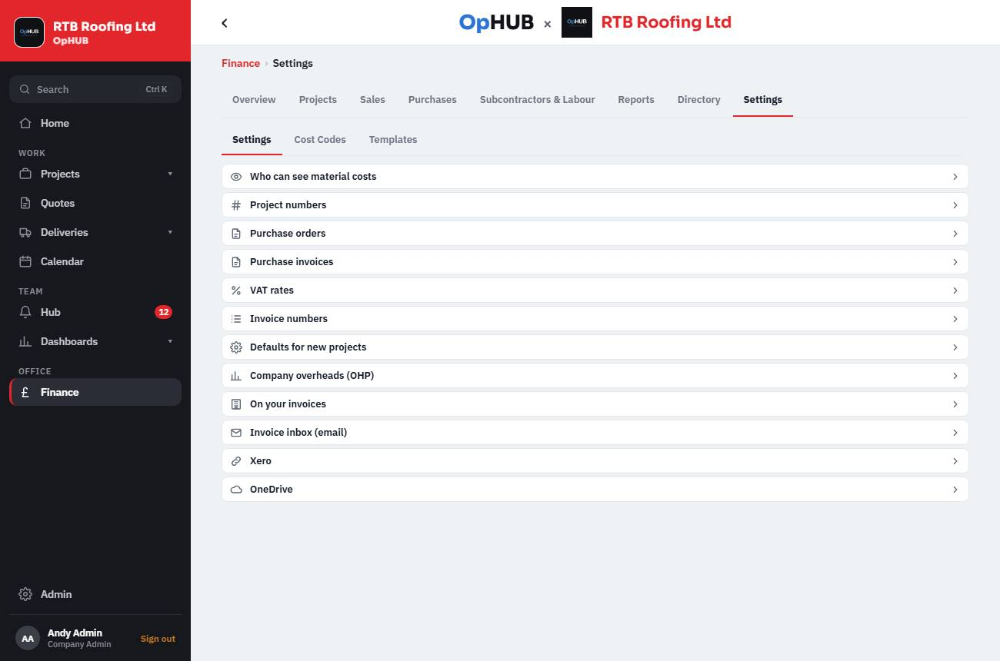

---

# Part 2: Projects as an operative

Most operatives use a phone; see the phone guide for full steps. Everything works the same on a laptop, using the left-hand menu and **THIS PROJECT**.

## O1. Signing in and the one-phone rule

**What it's for:** getting into the app safely.

1. Type your **Email** and **Password**. Click **Sign In**.
2. Forgot it? Click **Forgot Password?**, then **Send Reset Link**.
3. First time, sign the H&S Policy: **I have read and understood this policy — Sign**.

**One phone, one person:** everyone except PMs and admins is locked to one phone, and each phone to one person. A new phone needs approving by a PM or admin in **Admin Centre › Device Locks**.

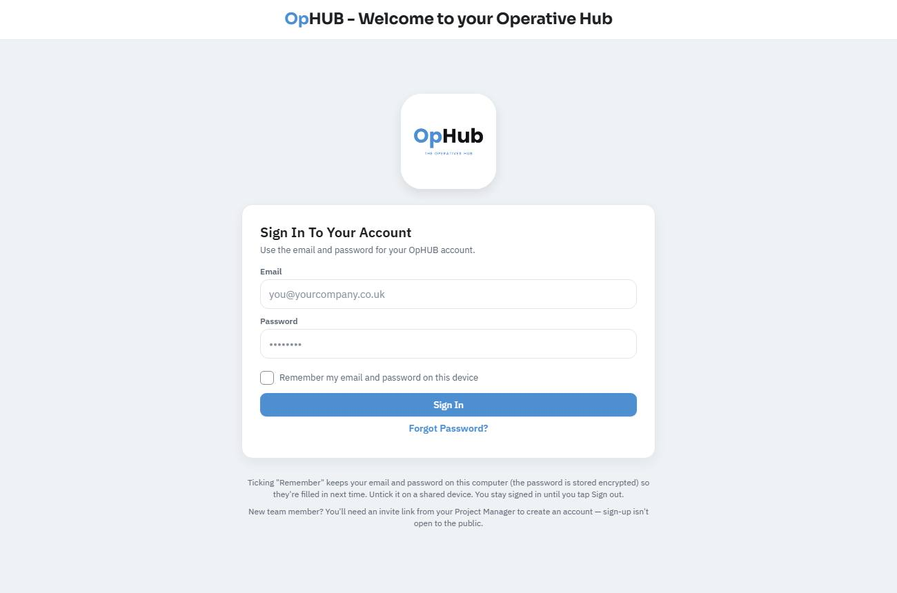

## O2. Your Home page and your projects

1. Home shows **Live jobs**, **Upcoming** and **Messages & tasks**.
2. Click **My projects** in the menu. Click a job.
3. The job page shows the job, today's calendar, tasks done, the weather, and **Check In / Out**.
4. Below are two columns of areas: **Schedule of Works**, **Health & Safety**, **Drawings, Spec's & Programme**, **Materials**, **Snagging & Variations**, **Calendar**.

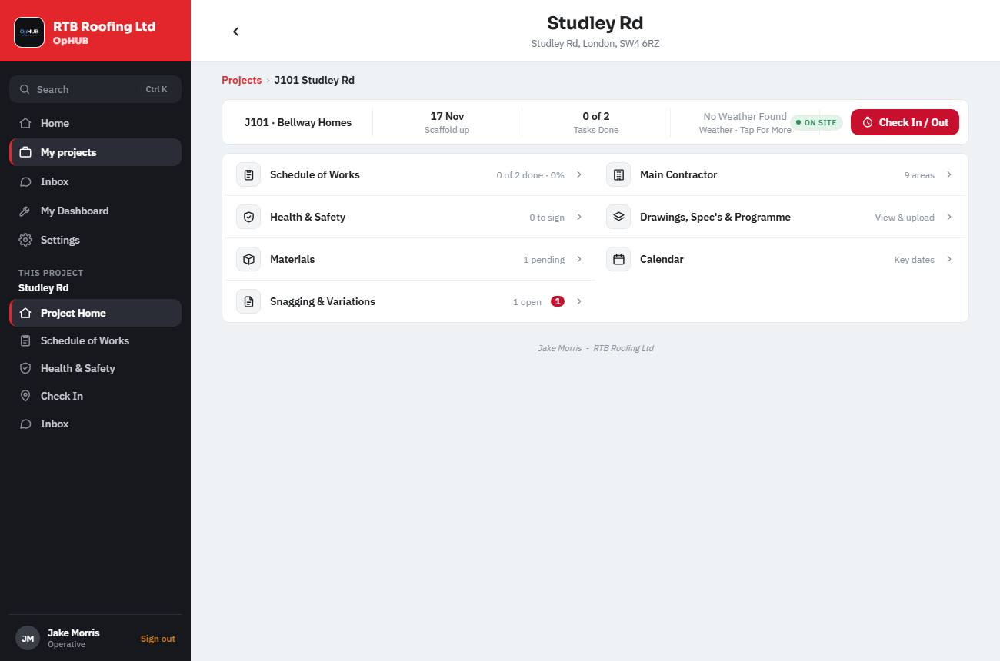

## O3. Check in and out with GPS

**What it's for:** showing you're on site. It needs the device's location, so it's best on a phone.

1. Click **Check In / Out** on the job, or **Check In** under **THIS PROJECT**.
2. Click **Check In**. Allow location if asked.
3. If you're too far from site, it tells you how far. Move closer and try again.
4. Click **Check Out** when you leave.

**What This Does In Finance:** PAYE check-in days are costed to the job at your day rate.

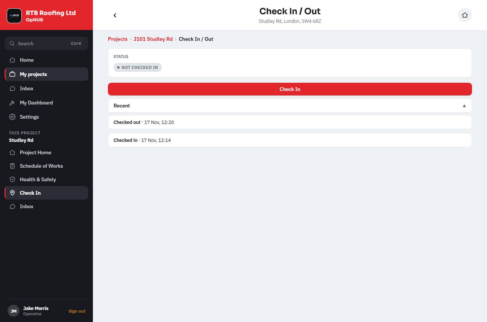

## O4. Schedule of Works and photos

1. Click **Schedule of Works** under **THIS PROJECT**.
2. Click **+ 📷** on a task to add photos.
3. Click **In Progress** and move the slider, or **Complete** and add a completed photo.

**What This Does In Finance:** your progress can fill the office's application for payment.

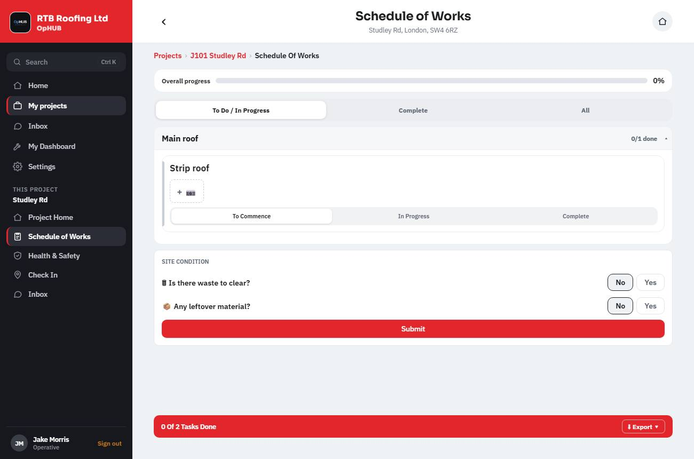

## O5. H&S: RAMS, COSHH, talks and briefings

1. Click **Health & Safety** under **THIS PROJECT**.
2. Open **RAMS** or **COSHH**. Click **✍ Tap to sign** on each, or **Sign All RAMS Documents**.
3. Open **TBT** or **Daily Briefings**. Click **✍ Tap to sign** on live ones.

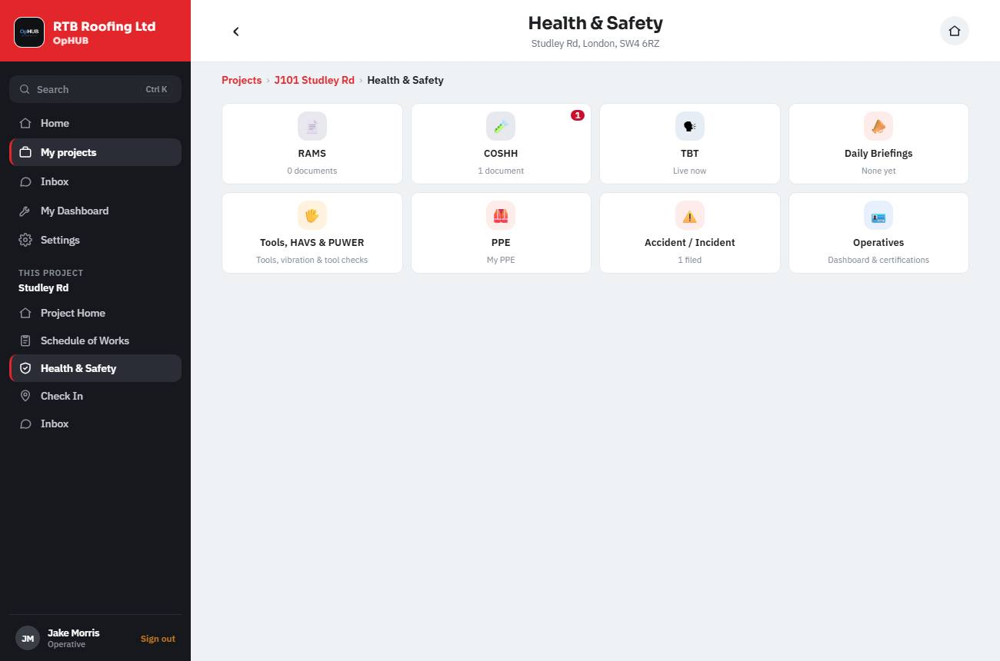

## O6. Permits, HAVS, PPE and incidents

1. **Permits** and **Site Inductions** are under **Main Contractor** on jobs that have it. Click **Sign this permit**.
2. **Tools, HAVS & PUWER:** enter HAVS minutes and click **Save Minutes**. Fill in the **PUWER Tool Inspection**.
3. **PPE:** click **+ Request PPE**, or sign for PPE you've been given.
4. **Accident / Incident:** click **⚠️ Report Accident / Incident / Near Miss**, then **Sign & Submit Report**.

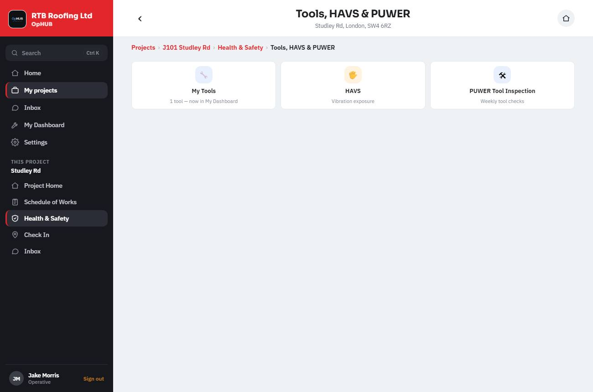

## O7. Snags and variations

1. Click **Snagging & Variations**.
2. **Snagging:** open a snag. When it's fixed, click **📷 Close Snag** and add a photo of the fix. (Managers add snags.)
3. **Variations:** add a photo, write the description, click **Submit Variation**.

**What This Does In Finance:** a variation the manager and client approve goes onto the next application for payment.

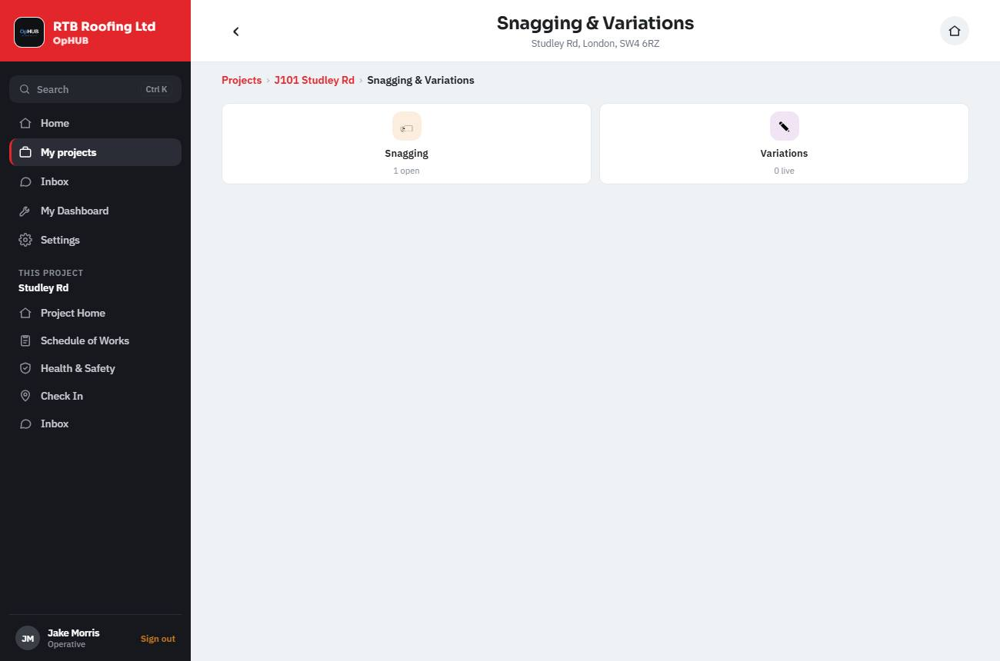

## O8. Materials

1. Click **Materials**.
2. Click **+ Request Materials**. Say what you need and when. Click **Request**.
3. On a delivery under **Coming to site**, click **Goods Received (GRN)**, then **✓ Save GRN**.
4. Tick collected items and click **✓ Mark Collected**.

**What This Does In Finance:** a GRN marks the PO received. A problem puts the supplier's invoices on hold.

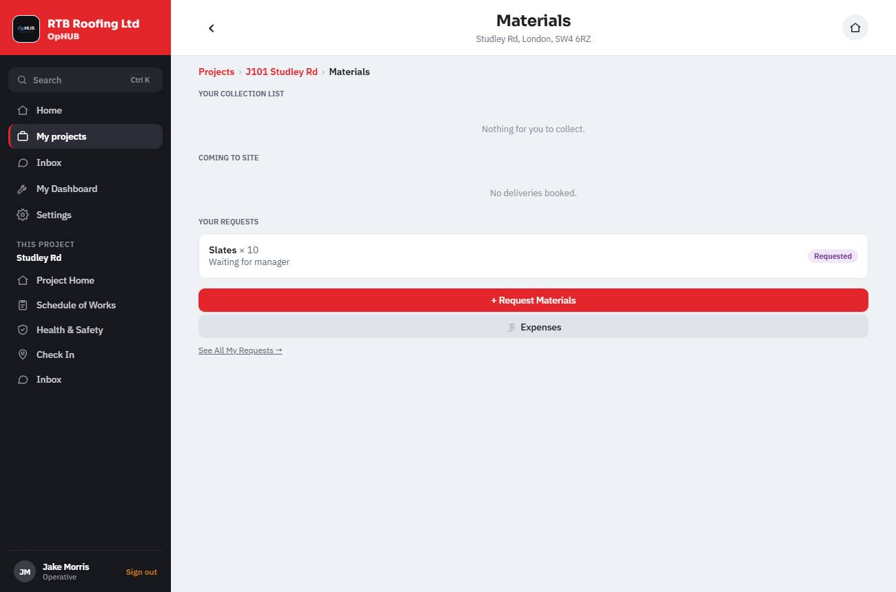

## O9. Drawings

1. Click **Drawings, Spec's & Programme**.
2. Open a folder and click a file to view it.

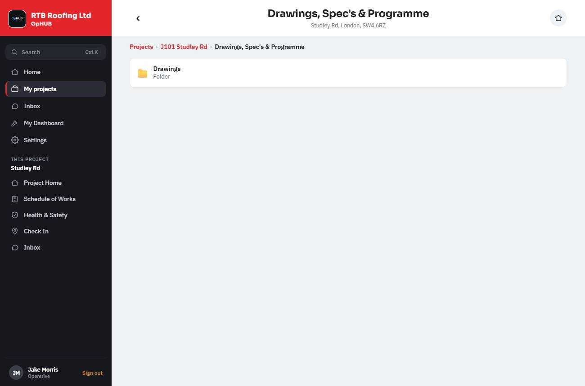

## O10. Messages and Inbox

1. Click **Inbox** in the menu. Tabs: **To sign / do**, **Messages**, **Company Chat**.
2. Inside a job, **Inbox** under **THIS PROJECT** shows that job's messages. Click **Send Reply** to answer.

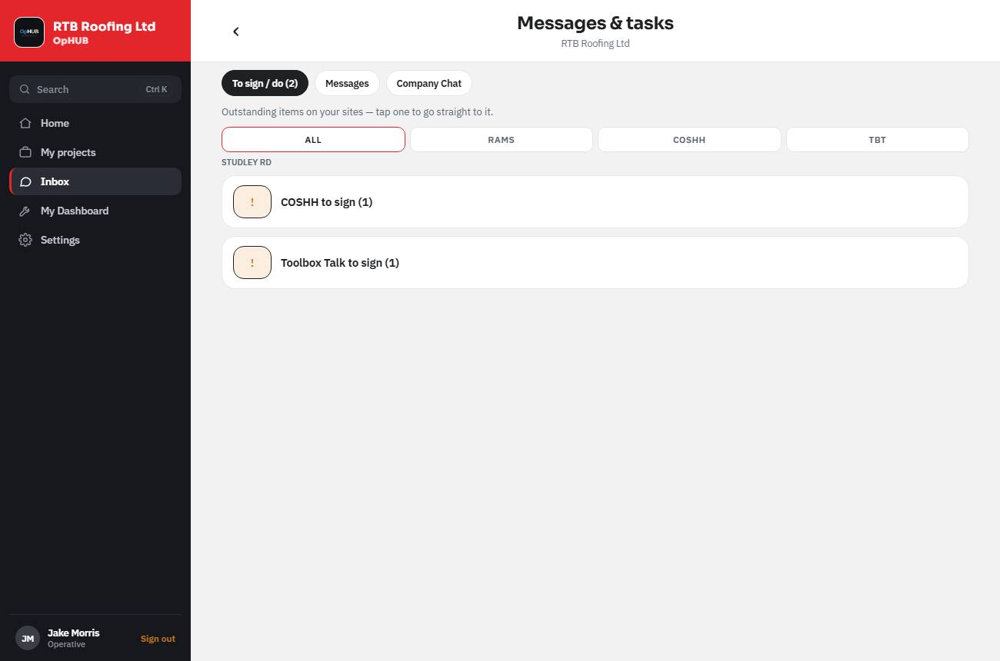

## O11. Expenses

1. Open the job's **Materials**, then **🧾 Expenses** (if your manager has turned it on).
2. Add photos or a PDF of each receipt. Check **Which job is this for?**
3. Click **Save & send**.

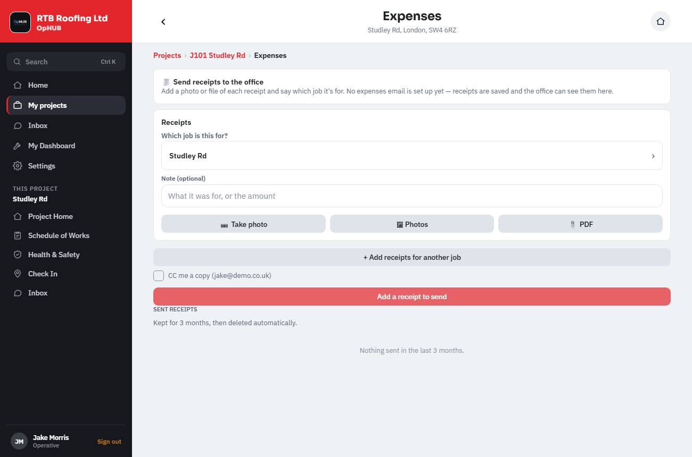

## O12. My Dashboard and Settings

1. Click **My Dashboard**. Add certificates, check **My Tools**, and use **📄 Export all (PDF)**.
2. Click **Settings**. Click **Phone Number** to change it. **Sign Out** is on its own under the list. Your employee record is in **HR › Employee Records**.

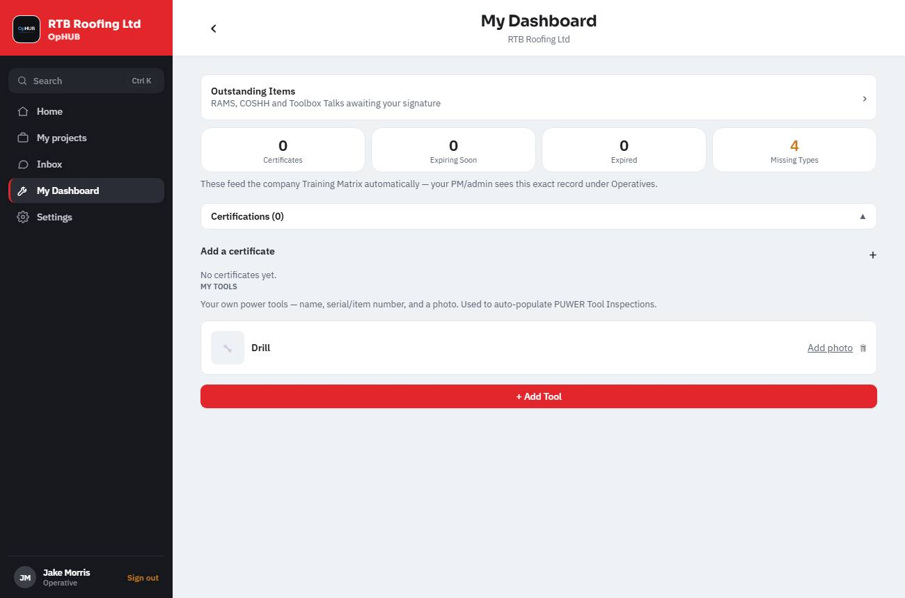

---

# Part 3: Projects as a project manager

The laptop is the best place for set-up work: new jobs, RAMS, orders and Admin.

## P1. Your Home page

**What it's for:** your day at a glance.

1. Click your company name at the top of the menu to go Home.
2. Four figures: **Live projects**, **On site now** (or **Due In**), **To do** (or **Quotes To Price**) and **Notifications**.
3. A **Needs you** card shows invoices and wages the office has sent you to book.
4. The sites map sits beside **Today**. Below are the next five working days: click the second dot under them for the five after. Click an item to open it, or the **+** at the foot of a day to add to it.
5. Tiles: **OpHUB Finance**, **Quotes**, **Dashboards** and **Reports & Surveys**.

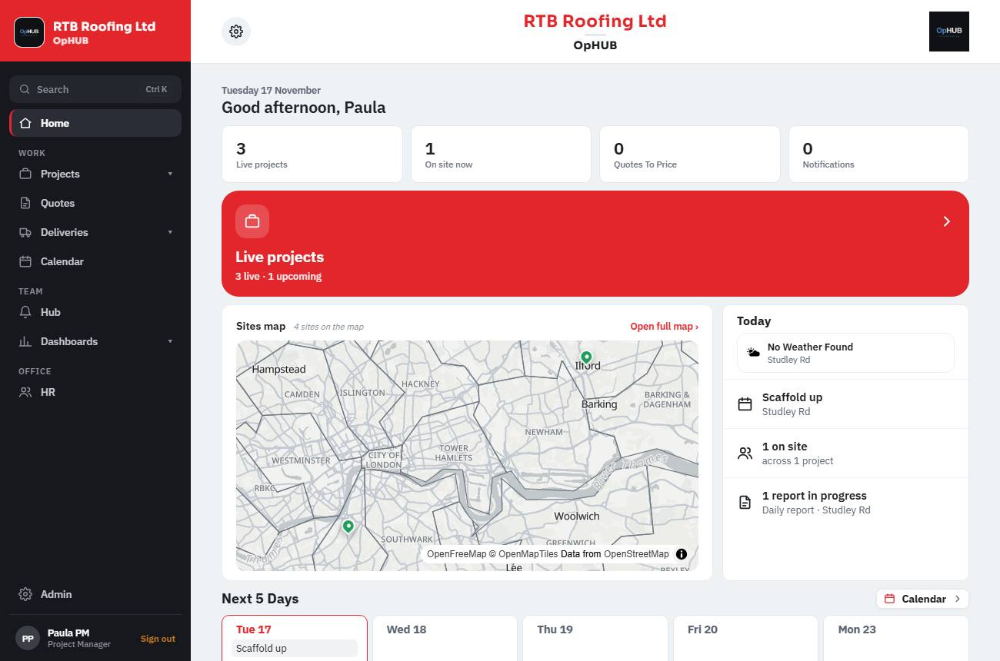

## P2. Making a project

**What it's for:** setting up a new job.

1. Click **Projects**, then **+ New Project**.
2. Fill in **Site Name \***, **Address \***, **Postcode** and **Job Number** (or leave the automatic one). A number another job has isn't taken.
3. Type the **Client Name \***; Directory clients come up as you type. Click **Contact Name** to choose one of the client's contacts (from the Directory, past projects and quotes); it fills **Contact Number** and **Contact Email**. Or type them in.
4. Tick **Multi-site job (several addresses / plots)** or **Repair / maintenance contract** if needed.
5. Tick **Create OneDrive folder** to make the job's folders.
6. Choose **Active** or **Upcoming**, and the **Start date \***. Click **Create Project**.

**What This Does In Finance:** the job appears in Finance › Projects, ready for its Finance page. With **Number new projects automatically** on in Finance, it gets the next number. This is how RTB makes jobs while Finance is on trial.

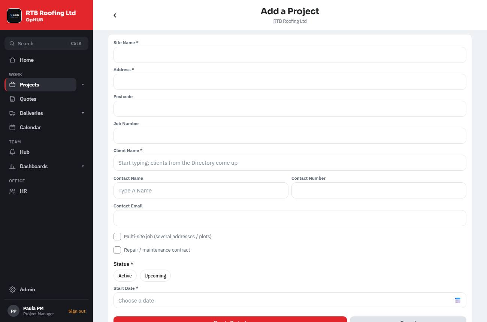

## P3. Site location and check-in area

**What it's for:** where operatives must be to check in, and how close.

1. Open the job. Click **Check In** under **THIS PROJECT**.
2. Under **Site Geofence**, click **Set Site Location**.
3. Click **Input GPS Co-Ordinates — type in latitude & longitude**. Paste the pair from Google Maps into the Latitude box. Plain numbers or degrees/minutes/seconds both work.
4. Check **Interpreted as**, and use **Find this spot on the map ↗** if unsure. Click **Save Location**.
5. Pick the check-in distance from the drop-down. Click **Save**.
6. It now reads **Set · Check-ins within** that distance. Click it to change it, or use the red bin to remove it.

On a multi-site job, set each address from **Settings & Admin › Multi-Site › 📍 Geofence (on Check In)**. Below the geofence: **Site Team — Live Status**, the history, and **⬇ Export ▾** in the footer bar.

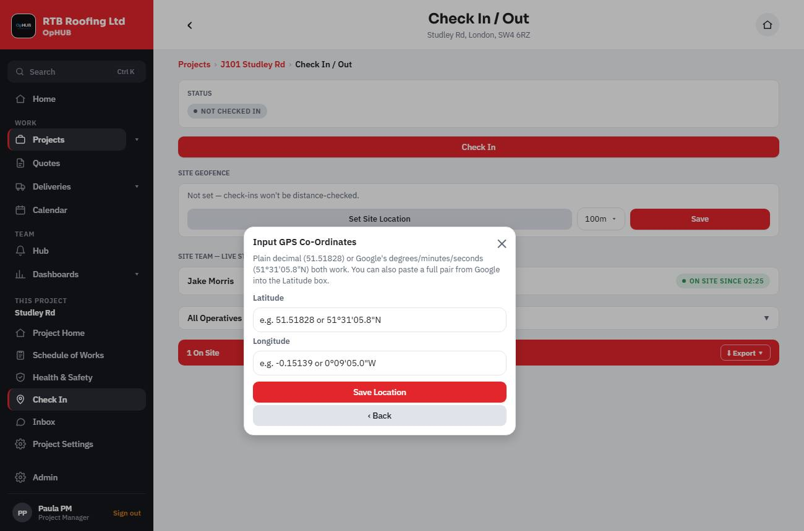

## P4. Putting the team on a job

**What it's for:** operatives only see, and check in to, jobs they're on.

1. Open the job. Click **Project Settings** under **THIS PROJECT**.
2. Open **👥 Team — operatives, site managers & clients**.
3. Open **Assign Operatives to Project**. Click a name to add or remove them.
4. Do the same in **Assign Site Managers** and **Assign Clients**.

New people join with a link from **Admin › People › Invites**.

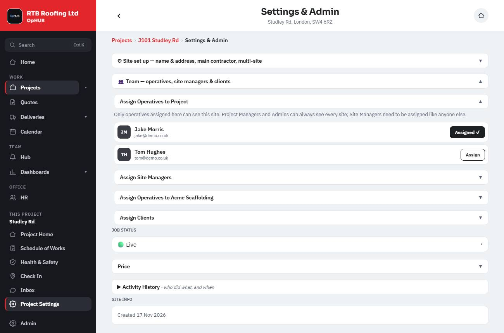

## P5. Project Settings

**What it's for:** the job's set-up, status and switches.

1. Click **Project Settings** under **THIS PROJECT**.
2. **⚙ Site set up:** **Amend Site Name, Address & Job Number**, **Main Contractor**, **Multi-Site** and its addresses, **Maintenance / Repair Contract**.
3. **Job Status:** **🟢 Live**, **🗓 Upcoming** or **🔒 Closed**.
4. **Price:** tick **This project is on a price**.
5. **☁️ OneDrive sync folder:** link, change or unlink the job's folder.
6. **▶ Activity History:** who did what, and when.

**What This Does In Finance:** a closed job drops out of Finance's pickers. Name and address changes show in Finance too.

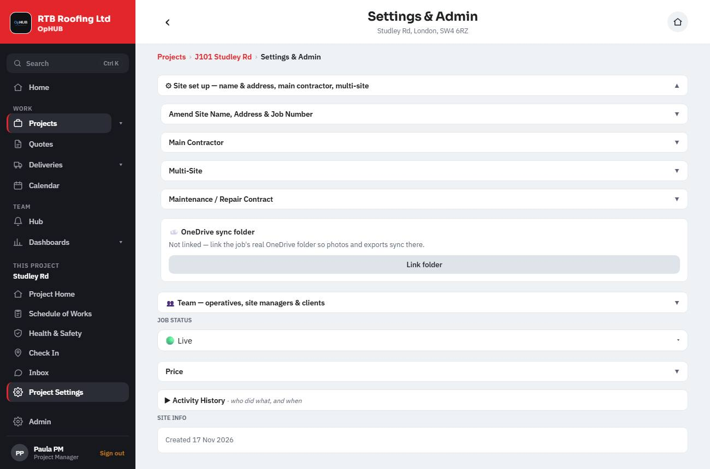

## P6. Client info and client POs

**What it's for:** the client contact and the client's purchase orders.

1. On the job's home page, click the client part of the info bar.
2. Click **Edit** to change the client details.
3. Click **+ Add Client PO**. Add the number, date and files.

**What This Does In Finance:** the client PO shows in the job's Project Admin in Finance, and goes on invoices. If Finance set the client up, change it in Finance.

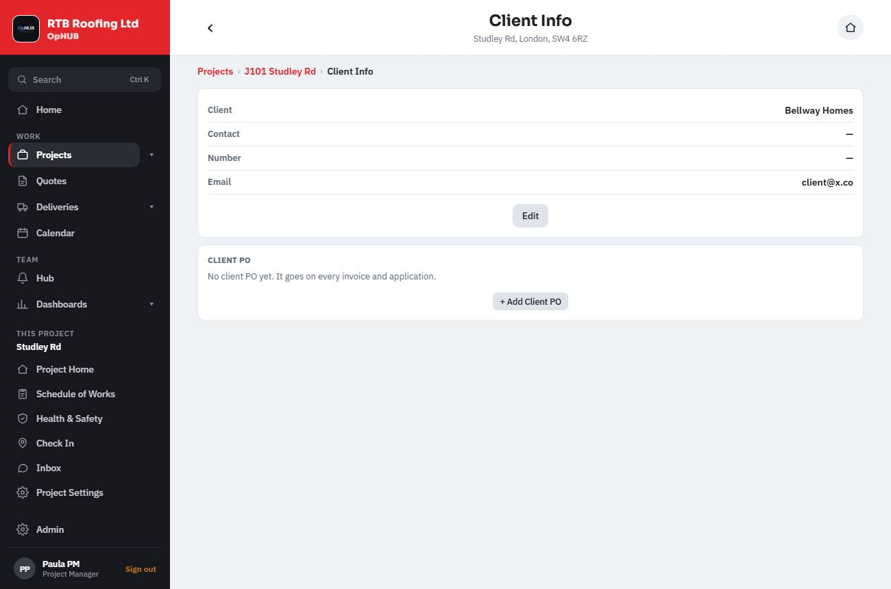

## P7. Schedule of Works

**What it's for:** the task list your team works through.

1. Click **Schedule of Works**. Click **+ Add Task** for one task.
2. Click **+ Section ▾** for **📁 Add Section** (new, or **📚 From the library**), **📊 Import schedule (Excel, CSV or PDF)** or **📐 Add Variation**.
3. Use a section's or task's **⋯** to rename, move, duplicate, delete, link an address or set **🔒 Who Can See This**.
4. On a main contractor job, use **🏗 Assign to subcontractor** on a task.
5. To finish a task with photos already there, tick them and click **✓ Mark complete with**.

**What This Does In Finance:** Finance can send its Bill of Quantities here as tasks. Progress then shows on Finance's applications.

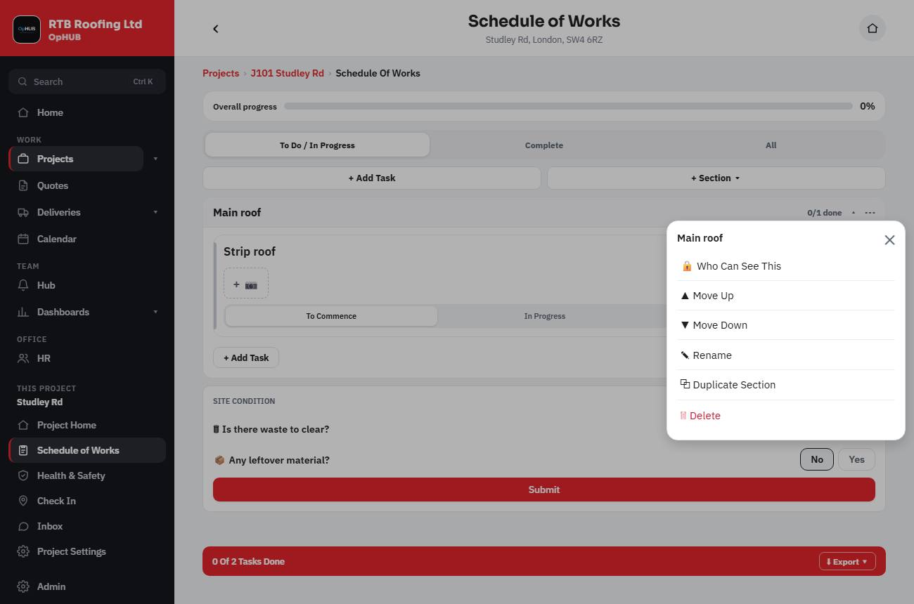

## P8. RAMS

**What it's for:** building or uploading RAMS, and getting them signed.

1. Open **Health & Safety**, then **RAMS**.
2. Under **Create / Upload RAMS**, click **🦺 Create RAMS** or **📄 Upload RAMS**.
3. To build one, click **+ Start new RAMS**. Name it, tick a template under **Start From A Template**, or **Or Copy Another Job's RAMS**. Click **Create RAMS**.
4. In the **RAMS Builder**, work through **Info**, **RA**, **SSOW** and **MS**. Use **+ Add From Library** and **+ New Hazard**.
5. On **Issue**, check **👁 Preview RA** and **👁 Preview MS**. Click **✓ Issue Risk Assessment & Method Statement**.
6. Click **🔔 Ask Outstanding To Sign** to chase anyone left. **📋 Save As Template** reuses it.

Issuing creates two documents in the job's RAMS list for operatives to sign. Re-issuing asks everyone to sign again.

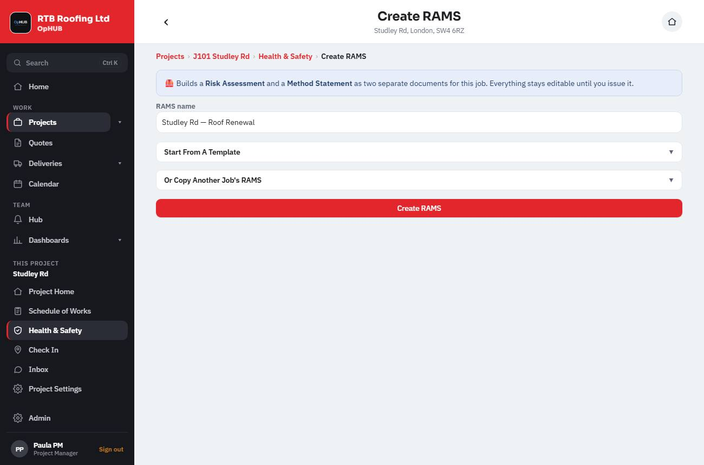

## P9. COSHH

**What it's for:** COSHH assessments for the team to sign.

1. Open **Health & Safety**, then **COSHH**.
2. Click **Create COSHH**. Choose **Add From Library**, **Create COSHH** or **Upload COSHH Assessment**.
3. **Add From Library:** tick documents or a whole folder. Click **Add**.
4. **Create COSHH:** upload a data sheet (it's read into the COSHH Library) or enter it by hand. Click **Issue**.

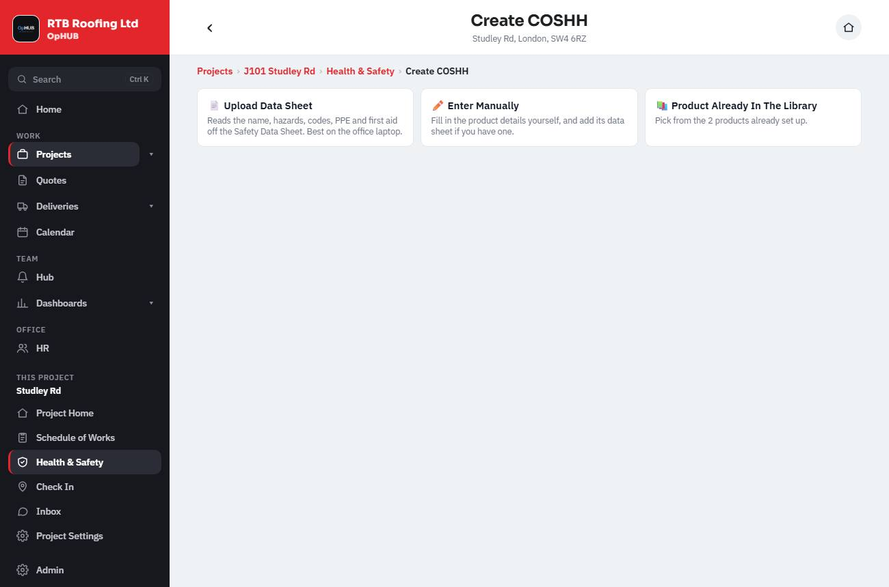

## P10. Toolbox talks and daily briefings

**What it's for:** giving talks and briefings, and getting them signed.

1. Open **Health & Safety**, then **TBT**. Use **Upload A Toolbox Talk** or **Write A Toolbox Talk**, then **Save To The TBT Bank**.
2. Open a talk. Choose **✍ Issue for Signing** (this job) or **📢 Issue company-wide**.
3. Use **🔔 Ask Outstanding to Sign**, then **✓ Mark as Completed**.
4. Open **Daily Briefings**. Click **+ New Briefing**. Fill it in. Click **Complete Briefing**, then **Issue For Signing**.

How often each job needs a talk is set in **Admin › Libraries › Toolbox Talks Required**.

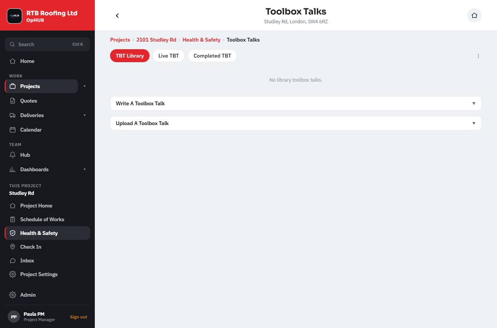

## P11. Permits, inductions and inspections

**What it's for:** main contractor paperwork. Switch it on in Project Settings › **Main Contractor**.

1. Click **Main Contractor** on the job. It holds the Construction Phase Plan, **Site Rules & Layout**, **Site Inductions**, **Subcontractors**, **Permits To Work**, **Inspections**, Asbestos Register, F10 and **Programme**.
2. **Permits To Work:** click **+ Issue Permit**. Choose type, contractor, who must sign, description and date. Click **Issue Permit**.
3. Close it with **Close Permit**. Hot works needs two fire-extinguisher photos.
4. **Site Inductions:** see who's done it. Edit the questions with **+ Add Question**.
5. **Inspections:** click **Start** on a template.

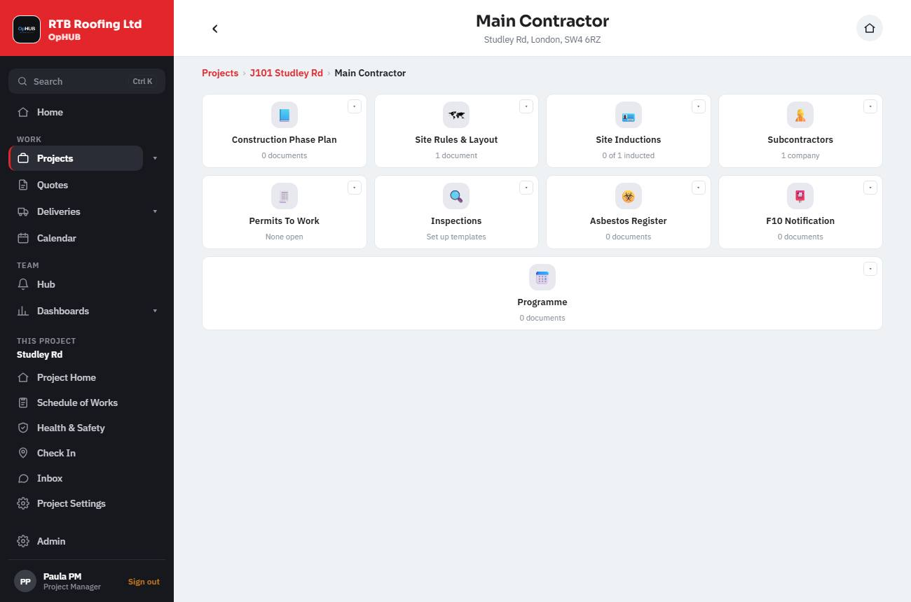

## P12. Incidents, HAVS and PPE

**What it's for:** site safety records.

1. **Accident / Incident:** read and export reports filed on the job.
2. **Tools, HAVS & PUWER:** the HAVS log and the weekly PUWER roster. Click a tile's **⋮** to choose who sees it.
3. **PPE:** click **+ Issue PPE**, or **Fulfil** a request. The company register is in **Admin › Libraries › PPE Log**.

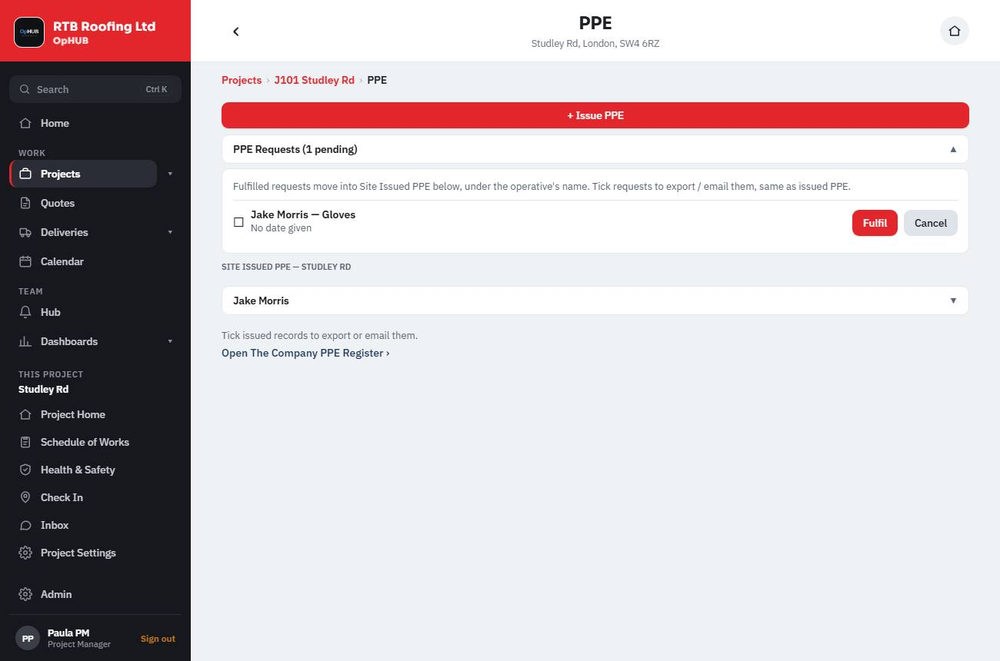

## P13. Materials and orders

**What it's for:** turning requests into orders.

1. Open **Materials**, then **Requests**.
2. On a request, click **🚚 Order from Merchant**. To order several together, tick them and click **🔗 Group into one request**.
3. Choose **Delivery**: **🚚 Deliver to site**, **🚐 Driver collection** or **👷 Operative collection**.
4. Pick the **Supplier** and **Branch**, the date, and a note. Add anyone to copy in.
5. Click **Confirm & send to** the supplier.
6. Or use **🏗 Yard Stock**, **📦 Add to collections** or **Close Request**.

**What This Does In Finance:** if you have Finance and **Raise a PO for every PM's order** is on, the order also raises a PO in Finance › Purchase Orders. Once that PO is sent, the request is locked here; changes are made in Finance. Yard stock used is costed to the job.

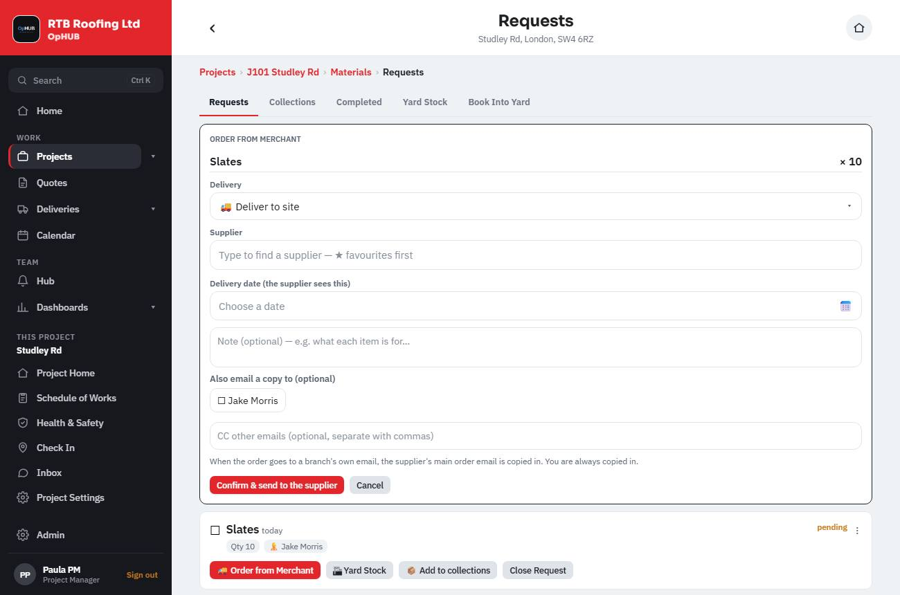

## P14. Material PO's and plant hire

**What it's for:** the job's orders without prices, and hired plant.

1. Open **Materials**, then **Material PO's**.
2. Click **Change ▾** on a PO: **Change The Delivery Date**, **Change The Note** or **Cancel The PO**.
3. **Ordered By The Office** on Materials shows POs Finance raised, and what's been received.
4. Open **Plant**. Click **+ Plant On Hire**. Fill in **What's On Hire**, **Supplier**, **Hire Ref** and **On Hire**.
5. Click **Off Hire** when it goes back.

**What This Does In Finance:** the PO changes are the same PO in Finance. Plant on hire appears in Finance › Plant Hire for Finance to add the rate.

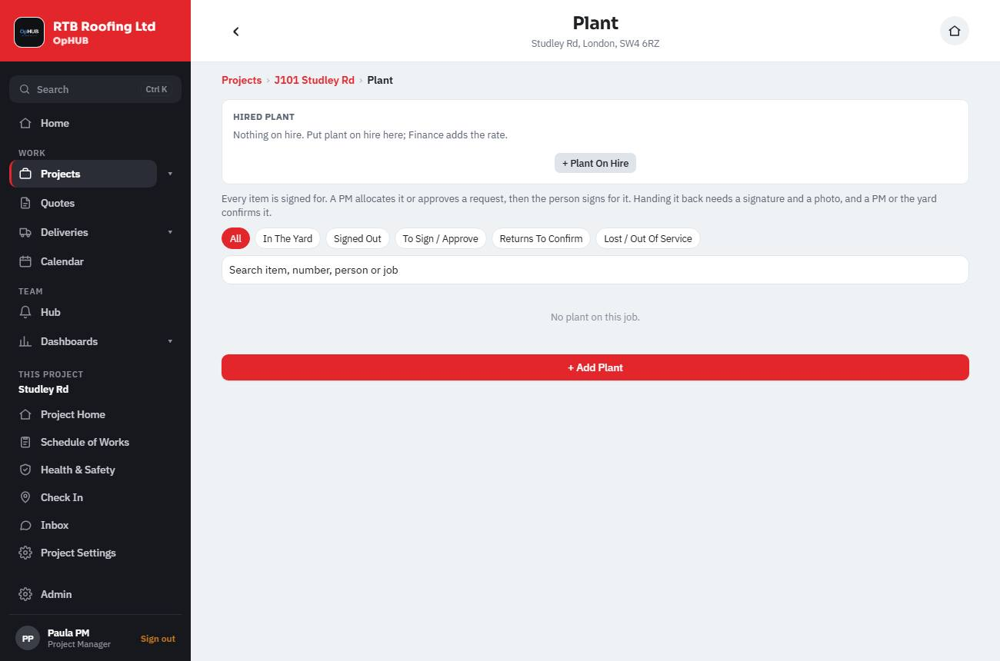

## P15. Subcontract orders

**What it's for:** recording who's doing what labour on the job.

1. Click **Subcontract Orders** on the job (or **Materials › Subcontract Orders** if it isn't on a price).
2. Click **+ New Subcontract Order**.
3. Choose **From Your Subcontractors (Optional)**, or type **Subcontractor** and **Email**.
4. Fill in **Scope Of Works** and **Notes**. Save.

**What This Does In Finance:** the order lands in Finance › Subcontractor POs, showing **Finance To Add The Value** until Finance adds value, CIS and retention.

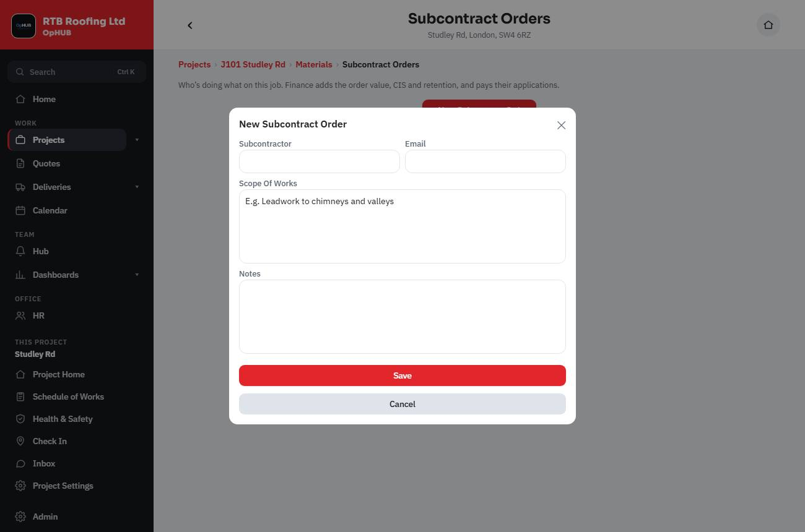

## P16. Deliveries

**What it's for:** planning the drivers' day.

1. Click **Deliveries** in the menu, then **Delivery Schedule**.
2. **To schedule** lists waste and leftovers flagged on site. Click **Schedule**.
3. Click **+ Add Delivery**. Choose the site, what's needed, where to collect from, date, drop and driver.
4. Use ▲▼ to reorder, or ⇄ to move to any drop.
5. **👁 Driver view**, **🚐 Vehicle health checks** and **🏗 Yard & Plant** are here too.

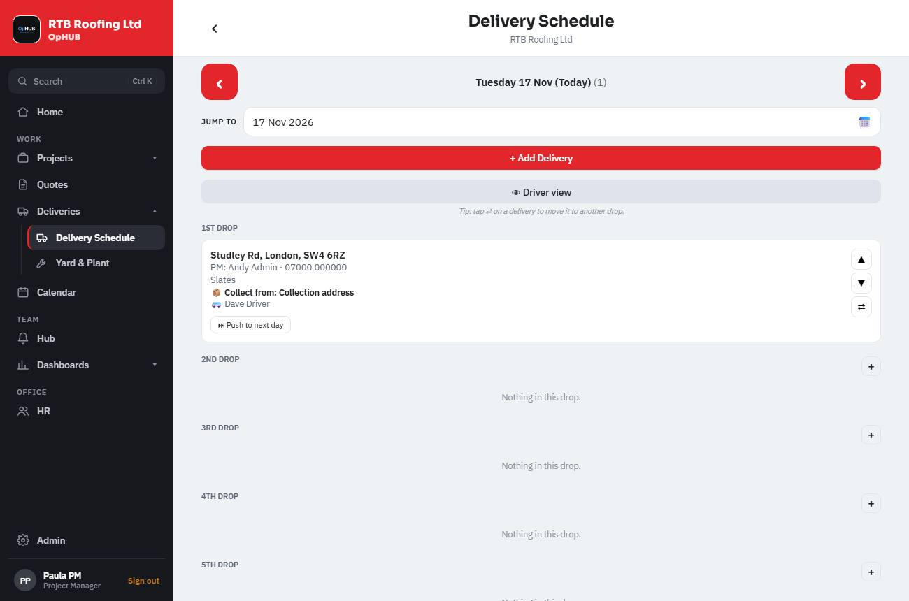

## P17. Drawings and documents

**What it's for:** the job's drawings, and its OneDrive folder.

1. Open **Drawings, Spec's & Programme**.
2. Click **+** for **📁 Add Folder** or **📄 Upload a file**. Choose what an upload supersedes.
3. Use a folder's menu to rename, move, delete or set **🔒 Who Can See This**.
4. If the job has a OneDrive folder: **☁️ Sync from OneDrive**, and the **Documents** row shows the folder as it is.
5. A programme upload offers to add a key date to the Calendar.

**What This Does In Finance:** the job's Finance **Documents** tab shows the same OneDrive folder.

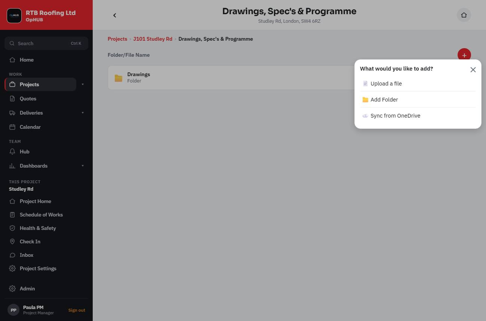

## P18. Calendar

**What it's for:** key dates for every job, or one.

1. Click **Calendar** in the menu. Filter by PM or site. Switch between month, week and 2 weeks.
2. Click **+ Add To Calendar** to add a date.
3. Inside a job, its **Calendar** row shows just that job. Click **＋ Add a key date**.
4. You can make a date private, repeat it, add an email reminder, or tick **🚚 Also Add to Delivery Schedule**.

**What This Does In Finance:** Finance's application dates show as **💷 Application due**. Delivery dates on Finance POs show too.

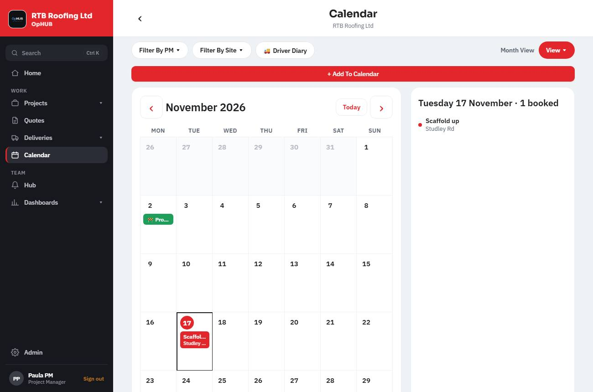

## P19. The HUB and To Book

**What it's for:** everything waiting for you.

1. Click **Hub** in the menu.
2. Tabs: **To Do**, **Projects**, **Finance**, **Company Chat** and **All**.
3. Filter by site, due date and whose jobs.
4. Click a row to go to it. Tick a to-do to finish it. Click **+ Add A To Do** to add one.

**What This Does In Finance:** the **Finance** tab shows invoice queries, invoices to book and wages to book. Click a query to answer it on the **Invoice Query** page. **To Book** (from the **Needs you** card) has **Book to this job** and **Send back**. (Finance doesn't send these to PMs while it's on trial.)

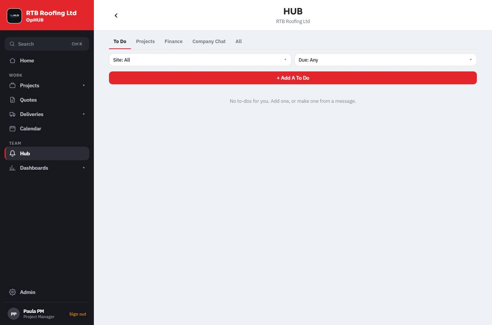

## P20. Reports and surveys

**What it's for:** reports across every job, and surveys with no job.

1. Click **Projects ▾**, then **Reports & Surveys**.
2. Click **Start a report**. Pick a project, or **General survey — not linked to a project**.
3. Filter by template or surveyor.
4. Tick completed ones. Click **Export PDF** or **Email**.

Report templates are built in **Admin › Libraries › Report Templates**.

## P21. Snags, day works and inspections

**What it's for:** the job's snags, day works and inspections.

1. Open **Inspections & Reports** on the job.
2. **Snagging:** **+ Add Snag**, tag people, and close with a photo.
3. **Day Works:** record the date, work, sheet number, labour, plant and materials. Attach the signed sheet. Use **Client ▾** for the client's answer.
4. **Reports:** click **+ New Report**, choose a template, click **Start**.

**What This Does In Finance:** day works go into Finance's day works by themselves. Finance adds the value.

## P22. Variations

**What it's for:** approving variations and taking them to the client.

1. Open **Inspections & Reports**, then **Variations**. Click one to open it.
2. Click **Approve**, **Decline** or **Modify Then Approve**. Set a value with **Save Value**.
3. Click **Client ▾**: **Issued To Client**, then **Client Approved…** (with who instructed it) or **Client Rejected**. Click **📎 Add Document** for the instruction.
4. Click **Add To Schedule Of Works**, then **Close Variation** when done.

**What This Does In Finance:** variations come into Finance's register by themselves, with your value. Only **Client Approved** ones go on an application.

## P23. The Price tile

**What it's for:** a job on a price: what each part is worth, and what's booked against it.

1. Tick **This project is on a price** in Project Settings › **Price**.
2. Click **Price** under **THIS PROJECT**. Each tile shows price, booked in and balance.
3. Click **+ Add price**. Open one to book each week: operatives, extra people and one-off costs. Click **💾 Save**.
4. Click **Price Sheets**, then **+ New Sheet**. Tick rate card items, click **Next — enter quantities**, then **Issue**.
5. **⋮ Manage** groups, colours and closes tiles.

**What This Does In Finance:** wages and operative invoices sent by Finance show here as **wages to book**. A Finance subcontractor PO can arrive as an issued price sheet. (Sending wages is off while Finance is on trial.)

## P24. Handover (O&M)

**What it's for:** the O&M manual, data sheets and guarantees at the end of a job.

1. Set the job to **🔒 Closed**. The **Handover** row appears.
2. Under **Practical Completion**, click **Set**. Add the date and **Defects Period (Months)**.
3. Click **📄 Upload Data Sheets** and **📄 Upload Certificates**, or **🔍 Find In OneDrive**.
4. Click **+ New O&M Manual**. Fill in the cover and **Scope Of Works**. Add to the back with **+ Add To The Back ▾**.
5. Click **📄 Download PDF**, **📝 Download Word** or **✉ Email PDF**.

**What This Does In Finance:** the practical completion date and defects period set the retention release dates in Finance. With Finance, the scope can be filled from the Bill of Quantities.

## P25. Quotes

**What it's for:** tracking tenders from enquiry to win.

1. Click **Quotes** in the menu. Tabs: **Live**, **Quoted**, **All**.
2. Click **+ New Enquiry**. Fill in the client and project.
3. Move it along the status bar. Click **📁 Make The Folder** for its OneDrive folder.
4. Click **📨 Submit Quotation** when it goes out. Chase with **✉ Chase Now**.
5. Won it? Click **🏆 Won – Convert To Project**, or **Won – Link To Job**.

## P26. Dashboards

**What it's for:** the big picture.

1. Click **Dashboards** in the menu.
2. **Company:** live, upcoming and closed jobs, open snags, signatures still needed, Schedule of Works progress and incidents.
3. **Operatives:** hours, check-ins, certificates and the **Training Matrix**.
4. Click a number to see the jobs behind it.

**What This Does In Finance:** people with Finance also see **Money** on the Company dashboard.

## P27. Admin: users, invites and phones

**What it's for:** your team's accounts and phones.

1. Click **Admin** at the bottom of the menu. Tabs across the top, as in Finance: **People**, **Libraries** and **Company**. 🔍 searches them all.
2. **Invites:** **Create Permanent Invite Link**, or **Generate One-Time Invite Link** and **Send Invite Email**.
3. **Users:** click a person to change their role or phone, or remove them.
4. **Device Locks:** **Approve** or **Deny** new phones. **Unlock** a phone.
5. **Check-In Logs** shows check-ins by site.
6. **Company › Job Numbers:** number new jobs automatically, with an optional prefix (for example RTB-2700). It's the same setting as Finance › Settings › Project Numbers, so a job set up in Projects or in Finance takes the next number, and no two jobs share one.

**What This Does In Finance:** an admin with Finance switches **Finance** on or off on each person's row in **Users**.

## P28. Admin › Roles › What Each Role Can Do

**What it's for:** deciding what each office role can use. Company admins only.

1. Click **Admin**, then **People**, then **Roles**.
2. Under **Your Roles**, choose a role from the drop-down ▾. A short brief shows what it uses the app as and who has it. Click **Edit Role** to rename it or change **Uses The App As**. Click **+ Add A Role** to add one. A new role starts the same as Project Manager.
3. Scroll to **What Each Role Can Do**. The role you chose opens there; change it with **Role ▾**. Only that role shows.
4. **Options** on the left are the parts it hasn't got. **In This Role** on the right are the parts it has.
5. Click a part with **→** to add it to the role, or one with **←** to take it out. You can also drag a part across. Each change saves straight away.

The parts: **Every Job**, **Create Projects**, **See Prices And Price Builder**, **Finance – View**, **Finance – Edit**, **Quotes**, **Schedule Of Works**, **Snags And Variations**, **Sign Off H&S**, **Raise Orders**, **Drawings And Documents**, **Team And Calendar**, **Manage People**, **Reports** and **Notifications And Emails**. Admins can always do everything.

**See Prices And Price Builder** shows a job's **Price** tile (each price, what's been booked against it and what's left), its **Price Sheets** for subcontractors (the price builder) and its **Subcontractors** tile. **Quotes** is the **Quotes** page, the tender tracker. Money in Finance follows **Finance – View** instead.

**What This Does In Finance:** **Finance – View** lets a role see Finance. Without **Finance – Edit**, it shows **View Only**. Without **Raise Orders**, **+ New ▾** has no purchase or subcontractor orders.

