# OpHUB: Phone Guide

How to use OpHUB on a phone. There is a separate laptop guide for the office.

## Contents

- [Getting around on a phone](#getting-around-on-a-phone)
- **Part 1: Finance on a phone**
  - [F1. Getting into Finance](#f1-getting-into-finance)
  - [F2. Projects](#f2-projects)
  - [F3. Sales](#f3-sales)
  - [F4. Purchases](#f4-purchases)
  - [F5. Subcontractors & Labour](#f5-subcontractors--labour)
  - [F6. Reports, Directory and Settings](#f6-reports-directory-and-settings)
- **Part 2: Projects as an operative**
  - [O1. Signing in and the one-phone rule](#o1-signing-in-and-the-one-phone-rule)
  - [O2. Your Home page and your projects](#o2-your-home-page-and-your-projects)
  - [O3. Check in and out with GPS](#o3-check-in-and-out-with-gps)
  - [O4. Schedule of Works and photos](#o4-schedule-of-works-and-photos)
  - [O5. Signing RAMS and COSHH](#o5-signing-rams-and-coshh)
  - [O6. Toolbox talks and daily briefings](#o6-toolbox-talks-and-daily-briefings)
  - [O7. Permits and site inductions](#o7-permits-and-site-inductions)
  - [O8. HAVS, PUWER and your tools](#o8-havs-puwer-and-your-tools)
  - [O9. PPE](#o9-ppe)
  - [O10. Accidents, incidents and near misses](#o10-accidents-incidents-and-near-misses)
  - [O11. Snags](#o11-snags)
  - [O12. Variations](#o12-variations)
  - [O13. Materials, deliveries and plant](#o13-materials-deliveries-and-plant)
  - [O14. Drawings](#o14-drawings)
  - [O15. Messages and Inbox](#o15-messages-and-inbox)
  - [O16. Expenses](#o16-expenses)
  - [O17. My Dashboard](#o17-my-dashboard)
  - [O18. Settings and your signature](#o18-settings-and-your-signature)
- **Part 3: Projects as a project manager**
  - [P1. Your Home page](#p1-your-home-page)
  - [P2. Making a project](#p2-making-a-project)
  - [P3. Site location and check-in area](#p3-site-location-and-check-in-area)
  - [P4. Putting the team on a job](#p4-putting-the-team-on-a-job)
  - [P5. Project Settings](#p5-project-settings)
  - [P6. Client info and client POs](#p6-client-info-and-client-pos)
  - [P7. Schedule of Works](#p7-schedule-of-works)
  - [P8. RAMS](#p8-rams)
  - [P9. COSHH](#p9-coshh)
  - [P10. Toolbox talks and daily briefings](#p10-toolbox-talks-and-daily-briefings)
  - [P11. Permits, inductions and inspections](#p11-permits-inductions-and-inspections)
  - [P12. Incidents, HAVS and PPE](#p12-incidents-havs-and-ppe)
  - [P13. Materials and orders](#p13-materials-and-orders)
  - [P14. Material PO's and plant hire](#p14-material-pos-and-plant-hire)
  - [P15. Subcontract orders](#p15-subcontract-orders)
  - [P16. Deliveries](#p16-deliveries)
  - [P17. Drawings and documents](#p17-drawings-and-documents)
  - [P18. Calendar](#p18-calendar)
  - [P19. The HUB and To Book](#p19-the-hub-and-to-book)
  - [P20. Reports and surveys](#p20-reports-and-surveys)
  - [P21. Snags, day works and inspections](#p21-snags-day-works-and-inspections)
  - [P22. Variations](#p22-variations)
  - [P23. The Price tile](#p23-the-price-tile)
  - [P24. Handover (O&M)](#p24-handover-om)
  - [P25. Quotes](#p25-quotes)
  - [P26. Dashboards](#p26-dashboards)
  - [P27. Admin: users, invites and phones](#p27-admin-users-invites-and-phones)
  - [P28. Admin › Roles › What Each Role Can Do](#p28-admin--roles--what-each-role-can-do)

---

## Getting around on a phone

There are three ways around the app on a phone.

1. **The bottom bar.** It changes with where you are.
   - Operatives, on your projects list: **Outstanding**, **Inbox**, **My Dashboard**, **Settings**.
   - Operatives, inside a job: **Home**, **SOW**, **Check In**, **Inbox**, **Settings**.
   - Managers, on the projects list: **Home**, **Deliveries**, a red **+** (new project), **HUB**, **Calendar**.
   - Managers, inside a job: **Home**, **Deliveries**, **Check In**, **HUB**, **Settings**.
2. **The ☰ menu.** Tap the three lines at the top left of any page. The full menu slides in. Inside a job it also lists **THIS PROJECT**. Tap outside it or ✕ to close it.
3. **Search.** On Home, tap the search box to find a report, drawing, material, to-do or snag.

Tap the address line at the top of a job page to copy the site's name and address.

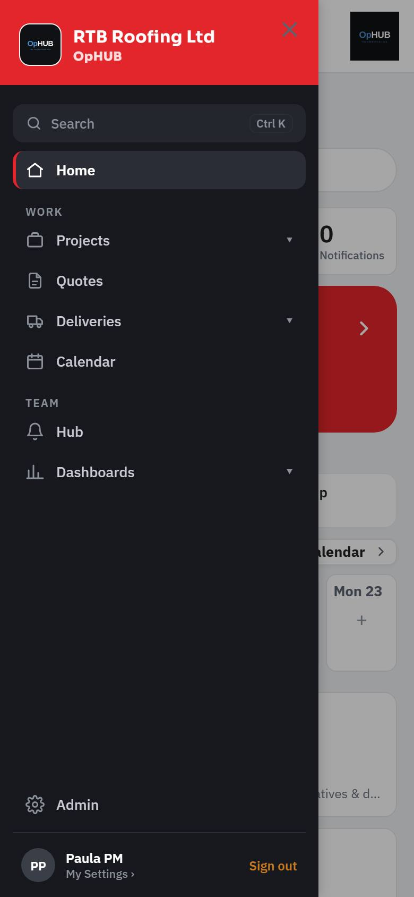

---

# Part 1: Finance on a phone

Finance is mainly a laptop job. The laptop guide covers every tab in full. Finance works on a phone too: the same tabs, scrolling sideways. Use it on the go to check a figure, approve an invoice or look up a job.

> **Finance is on trial for RTB.** While it is, nothing is sent from Finance: no emails, no Xero, no pushes to PMs. Finance › Overview shows a 🔒 line saying so.

## F1. Getting into Finance

**What it's for:** money in and money out, for the whole company or one job.

1. On Home, tap the **OpHUB Finance** tile. Or tap ☰ and then **Finance**.
2. Inside a job, tap ☰ and then **Finance** under **THIS PROJECT**. It opens that job's Finance page.
3. Swipe the tab row sideways: **Overview**, **Projects**, **Sales**, **Purchases**, **Subcontractors & Labour**, **Reports**, **Directory**, **Settings**.
4. On **Overview**, tap any figure to open the list behind it. **Needs Attention** lists what's waiting.

You only see Finance if it's switched on for you (Admin › Users › **Finance**). If your role can look but not change, Finance shows **View Only**.

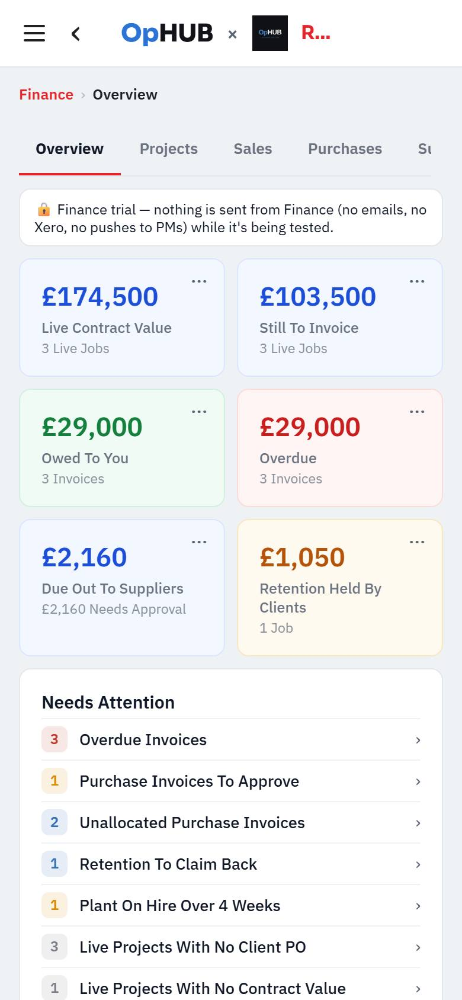

## F2. Projects

**What it's for:** every job with its value and PM, and each job's own Finance page.

1. Tap **Projects**. Use **Live**, **Upcoming**, **Closed** or **All**.
2. Tap a heading to sort. Type in the box under a heading to search.
3. Tap a job to open it. Its tabs are **Overview**, **Sales**, **Purchases**, **Subcontractors & Labour**, **Bill Of Quantities**, **Documents** and **Project Admin**.
4. Tap **Go To Project** to jump to the same job in Projects.
5. Tap **+ New** to add an invoice, application, purchase order, purchase invoice, plant hire or subcontractor order.

**What This Does In Projects:** a job's name, address and status changed in **Project Admin** change the job in Projects. While Finance is on trial, **+ New Project** in Finance sends you to Projects instead, so set new jobs up there.

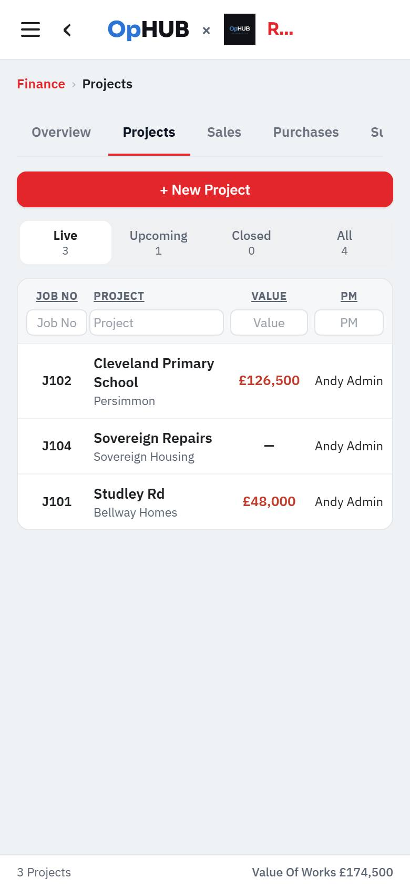

## F3. Sales

**What it's for:** money coming in: **Applications & Certificates**, **Invoices** and **Retention**.

1. Tap **Sales**, then the tab you want.
2. Tap a row to open it. Use the ▾ under the amount to change which ones show.
3. On an invoice, tap **+ Record payment** when the client pays.

**What This Does In Projects:** an application can use the site team's Schedule of Works progress (**Use site progress**). Variations the client approved in Projects go onto the next application.

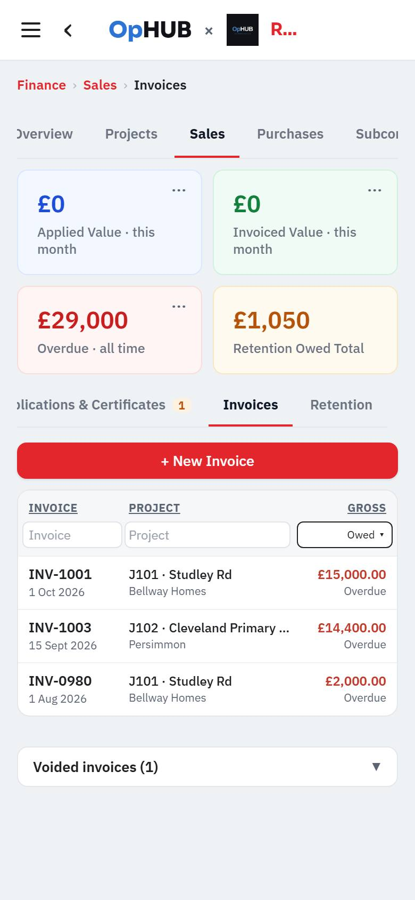

## F4. Purchases

**What it's for:** money going out: **Purchase Invoices**, **Purchase Orders**, **Statements**, **Yard**, **Plant Hire** and **Price Lists**.

1. Tap **Purchases**. It opens on **Purchase Invoices**.
2. Use the tabs: **Received**, **With A PM**, **Needs Checking**, **Approved**, **All**.
3. Tap an invoice to check it, then tap **Approve Invoice**.
4. Tap **Add Invoices** to photograph or choose a supplier invoice.

**What This Does In Projects:** POs raised from a job's Materials appear under **Purchase Orders**. A problem reported on a delivery puts that PO's supplier invoices on hold.

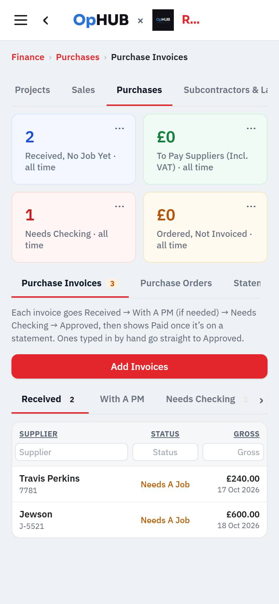

## F5. Subcontractors & Labour

**What it's for:** operative invoices, wages, subcontractor POs, their applications and CIS.

1. Tap **Subcontractors & Labour**.
2. Swipe the tabs: **Operative Invoices**, **Wages To Book**, **Pay Run**, **Subcontractor POs**, **Applications & Certificates**, **CIS**, **People & Rates**.
3. Tap a row to open it.

**What This Does In Projects:** a subcontract order a PM raises in Projects lands in **Subcontractor POs** for Finance to add the value.

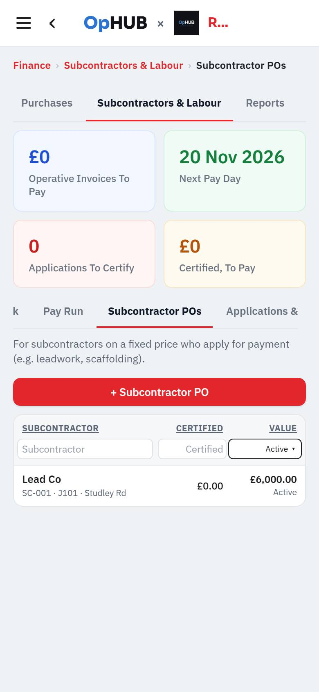

## F6. Reports, Directory and Settings

**What it's for:** reports, your clients, suppliers and labour, and Finance's own settings.

1. Tap **Reports** and pick one. On a phone each report shows as cards.
2. Tap **Directory** for **Clients**, **Estimating**, **Suppliers** and **Labour (CIS)**.
3. Tap **Settings** for numbering, VAT, bank details and Xero. These are easier on a laptop.

**What This Does In Projects:** if **Number new projects automatically** is on, a new project in Projects gets the next job number by itself.

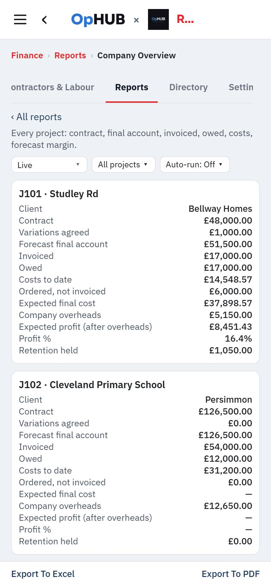

---

# Part 2: Projects as an operative

This is the part you'll use most. Everything here is on your phone.

## O1. Signing in and the one-phone rule

**What it's for:** getting into the app safely, on your own phone.

1. Open OpHUB. Type your **Email** and **Password**.
2. Tick **Remember my email and password on this device** if you like.
3. Tap **Sign In**. Forgot it? Tap **Forgot Password?**, then **Send Reset Link**.
4. The first time, sign the company's H&S Policy. Tap **I have read and understood this policy — Sign**.
5. New starters get a **Getting Started** card on Home. Tap it and follow the steps.

**One phone, one person.** Your account works on one phone, and that phone works for one person.
- A new phone needs approving. Ask your PM or admin to approve it in **Admin Centre › Device Locks**.
- If someone else is signed in on that phone, you'll be told whose phone it is.

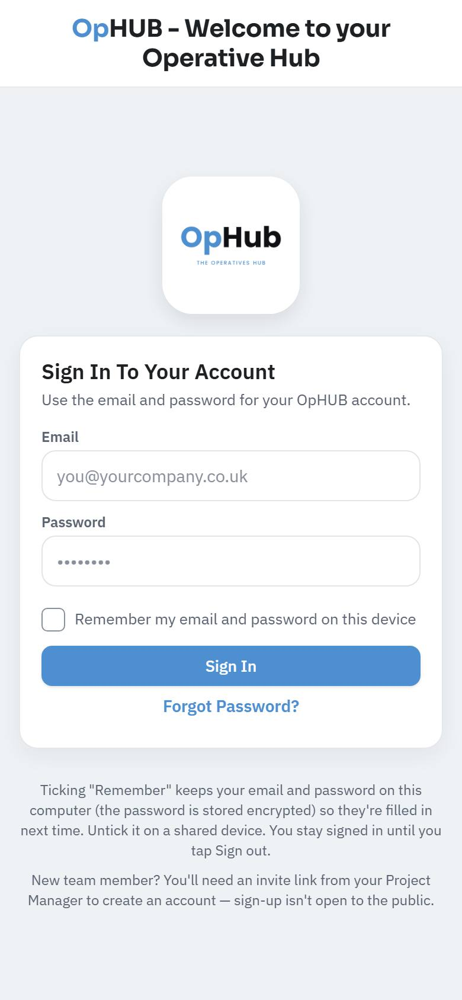

## O2. Your Home page and your projects

**What it's for:** a quick look at your day, then into your jobs.

1. Home shows **Live jobs**, **Upcoming** and **Messages & tasks**.
2. Tap the red **My projects** card to see your jobs. You only see jobs you're assigned to.
3. Tap a job. The top shows the job, today's calendar, tasks done and the weather.
4. Under that are the job's areas: **Schedule of Works**, **Health & Safety**, **Drawings, Spec's & Programme**, **Materials**, **Snagging & Variations** and **Calendar**. Some jobs also have **Main Contractor**.
5. Tap **Calendar** to see key dates. Anyone on the job can add one.

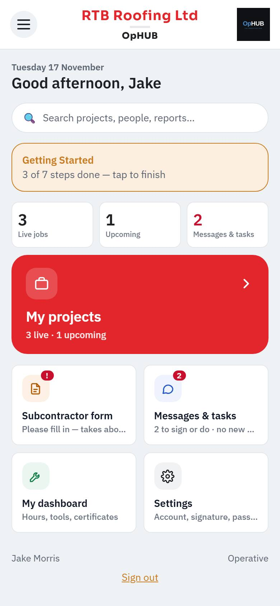
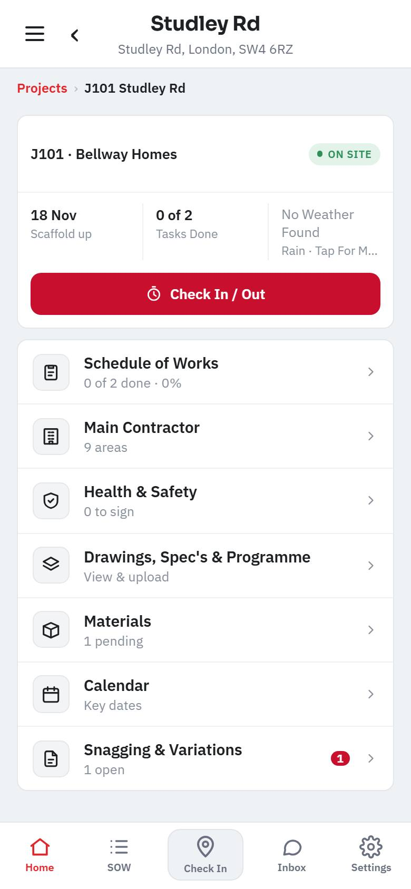

## O3. Check in and out with GPS

**What it's for:** showing you're on site. Your phone's GPS checks you're close enough.

1. Open the job. Tap the red **Check In / Out**, or **Check In** in the bottom bar.
2. Tap **Check In**. It says **Getting GPS lock…** while it finds you.
3. If asked, allow OpHUB to use your location.
4. You'll see **Checked in** and the time. **Status** says **On site since** that time.
5. When you leave, tap **Check Out** the same way.

- **Too far away?** It tells you how far you are, and how close you need to be. Move closer and try again.
- **Multi-site job:** pick the address first. You can only be checked in at one address. Before you check out, each Schedule of Works task for that address needs at least one photo.
- Your check-in tells the rest of the team on the job.

**What This Does In Finance:** for PAYE staff, each day you check in is costed to that job at your day rate. The office brings these in as wages each week.

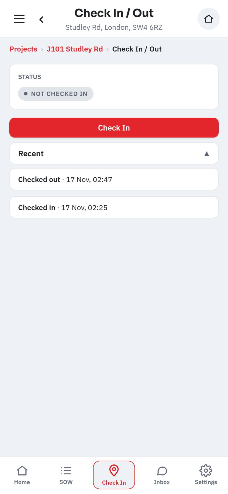

## O4. Schedule of Works and photos

**What it's for:** the job's task list. You show progress with photos.

1. Tap **SOW** in the bottom bar, or **Schedule of Works**.
2. Filter with **To Do / In Progress**, **Complete** or **All**.
3. Tap **+ 📷** on a task to add photos. Choose **📸 Take a photo** or **🖼 Choose from your photos**.
4. Starting a task? Tap **In Progress**. Slide the bar to show how far along it is.
5. Finished? Tap **Complete**, then **📷 Add completed photos**. A task can't be completed without a completed photo.
6. Where it asks **Site condition**, answer **Yes** or **No** for waste to clear and leftover material. Tap **Submit**. You can only submit once.

No signal? Photos wait on your phone and send later.

**What This Does In Finance:** when the office has linked the schedule to the Bill of Quantities, your progress shows on their application for payment. Waste or leftover answers go to the office's Delivery Schedule to collect.

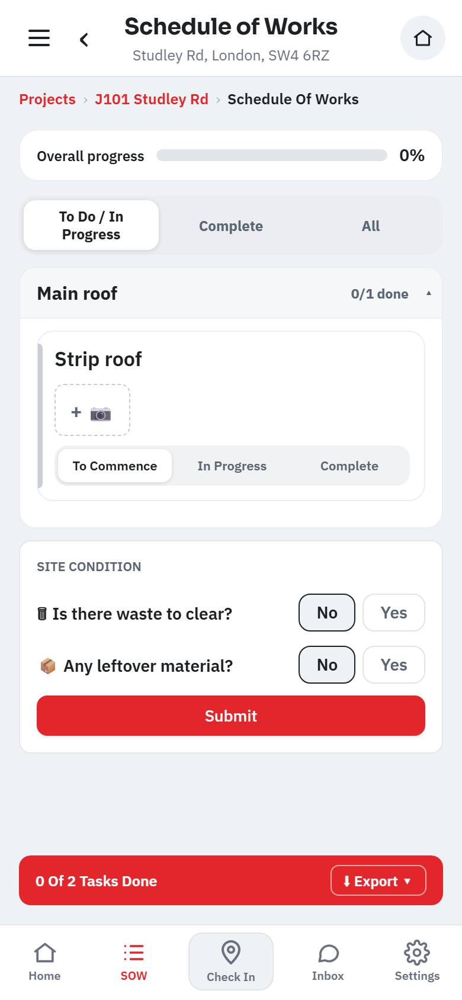

## O5. Signing RAMS and COSHH

**What it's for:** reading and signing the job's risk assessments, method statements and COSHH sheets.

1. Tap **Health & Safety**. The row shows how many are **to sign**.
2. Tap **RAMS**. Tap a document to read it.
3. Tap **✍ Tap to sign** under it.
4. First time? You'll draw your signature. Tap **Save Signature**.
5. Or tap **Sign All RAMS Documents** to sign every one left.
6. Do the same in **COSHH**.

Signed ones show **Signed** and the date. If a RAMS is re-issued, you'll be asked to sign again.

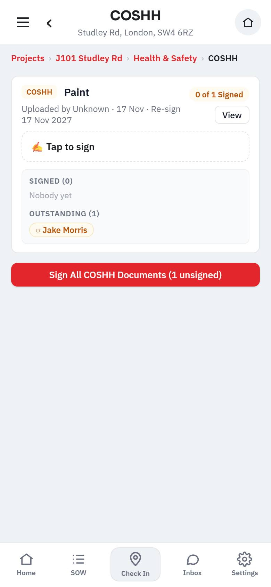

## O6. Toolbox talks and daily briefings

**What it's for:** signing that you've had the talk or the briefing.

1. Tap **Health & Safety**, then **TBT**.
2. Open the live talk. Read it. Tap **✍ Tap to sign**.
3. Back in **Health & Safety**, tap **Daily Briefings**. They're grouped by week.
4. Open a briefing marked **Tap to sign**. Tap **✍ Tap to sign**.

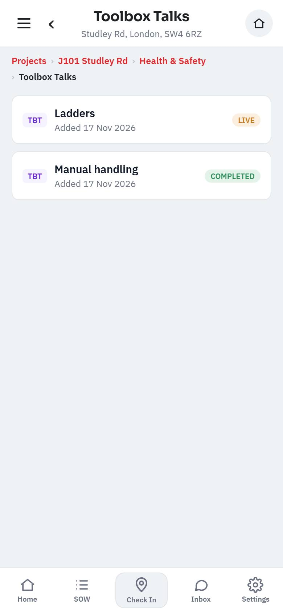

## O7. Permits and site inductions

**What it's for:** jobs where RTB is the main contractor. These jobs have a **Main Contractor** row.

1. Tap **Main Contractor**.
2. Tap **Site Inductions**. Tick every item. Fill in **Emergency Contact Details**.
3. Tap **Next: Health Questionnaire ›**. Answer it. Any **Yes** needs details. Then sign. You only do this once.
4. Tap **Permits To Work**. Open a permit that needs you.
5. Tap **Sign this permit**.

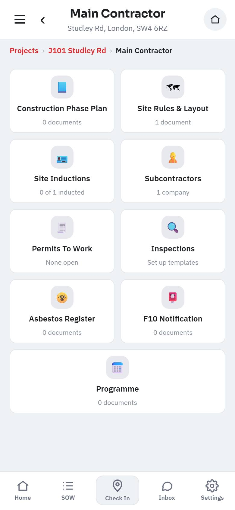

## O8. HAVS, PUWER and your tools

**What it's for:** logging vibration time and checking your tools each week.

1. Tap **Health & Safety**, then **Tools, HAVS & PUWER**.
2. **HAVS:** pick the week. Type the minutes for each tool on each day. Tap **Save Minutes**.
3. **PUWER Tool Inspection:** for each tool, tick the five checks. Add comments. Tap **Save Inspection**. It locks once saved.
4. **My Tools:** the tools you've registered.

HAVS may not show for you unless your manager has switched it on for the job.

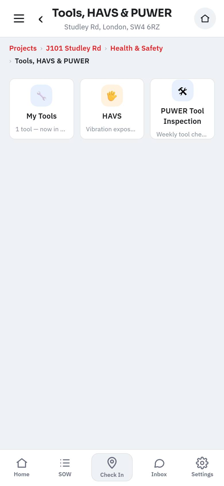

## O9. PPE

**What it's for:** asking for PPE and signing for what you get.

1. Tap **Health & Safety**, then **PPE**.
2. Under **Awaiting Your Signature**, tap **I confirm receipt of this PPE — Sign**.
3. To ask for something, tap **+ Request PPE**. Fill in **Item name** and **Date needed (optional)**.
4. Tap **Submit Request**. It shows under **My Requests**.

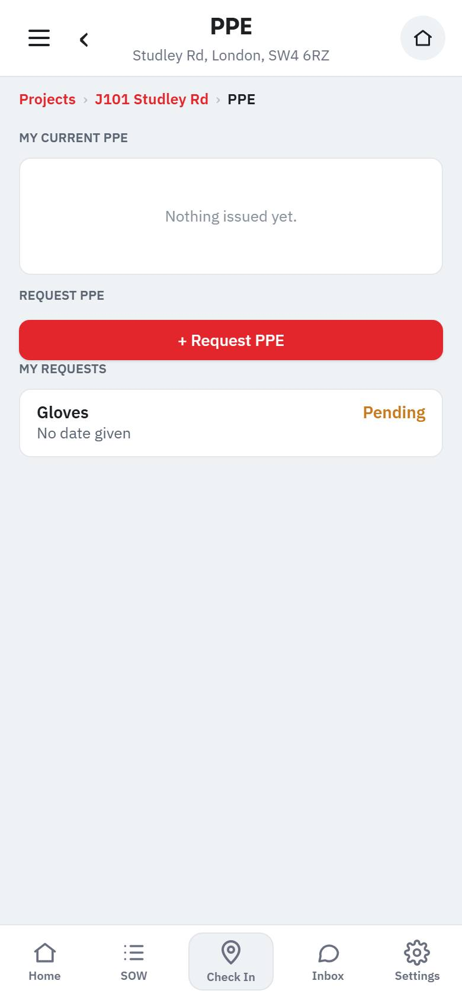

## O10. Accidents, incidents and near misses

**What it's for:** reporting anything that went wrong, or nearly did.

1. Tap **Health & Safety**, then **Accident / Incident**.
2. Tap **⚠️ Report Accident / Incident / Near Miss**.
3. Answer the questions. Set the **Date of incident**.
4. Tap **📷 Add Photo(s)** for the area and any damage.
5. Tick the operatives involved.
6. Tap **Sign & Submit Report**.

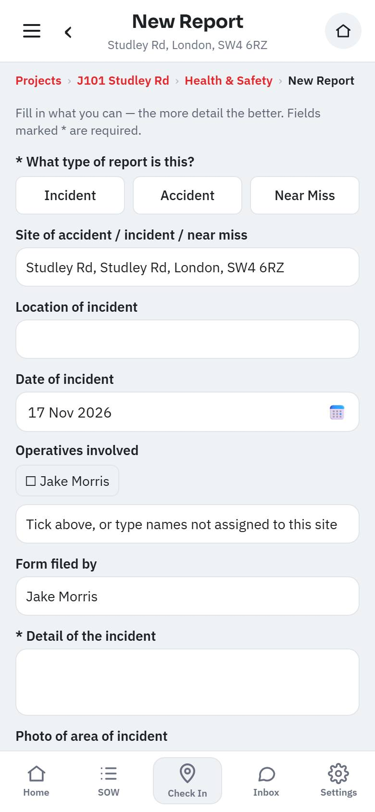

## O11. Snags

**What it's for:** seeing the job's defects and closing them when they're fixed.

1. Tap **Snagging & Variations**, then **Snagging**.
2. **Live** lists the open snags. Your manager adds them with **+ Add Snag**.
3. Tap a snag to open it and see its photos.
4. Fixed it? Tap **📷 Close Snag** and take a photo of the fix.
5. Check the photo. Tap **Yes, Close It**.

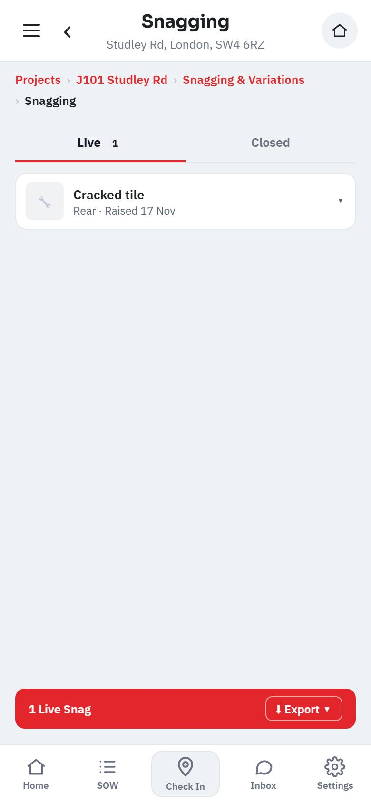

## O12. Variations

**What it's for:** flagging extra or changed work, with a photo.

1. Tap **Snagging & Variations**, then **Variations**.
2. Under **Raise a variation**, tap **📷 Tap to add a photo**. A photo is required.
3. Tap **✏️ Mark up photo** to draw on it if you need to.
4. Write the **Description**: what's changed and why.
5. Tap **Submit Variation**. Track it under **Live**. A declined one shows the reason.

**What This Does In Finance:** once a manager approves it and the client approves it, it goes into Finance's variations and onto the next application for payment.

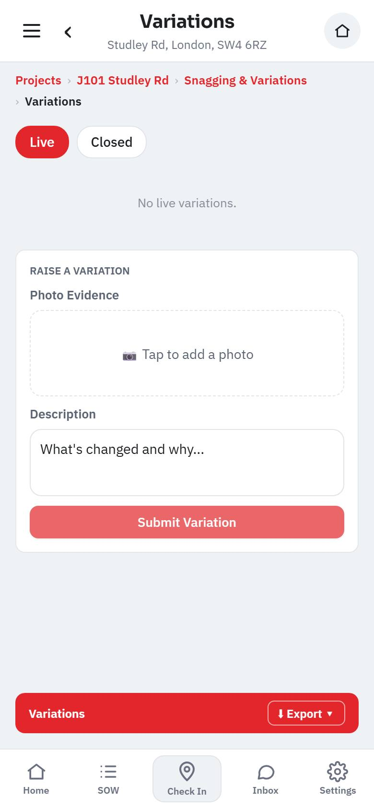

## O13. Materials, deliveries and plant

**What it's for:** asking for materials, picking them up, and checking deliveries in.

1. Tap **Materials**.
2. **Your collection list:** tick what you've picked up. Tap **✓ Mark Collected**.
3. **Coming to site:** when a delivery arrives, tap **Goods Received (GRN)**.
4. Leave **Everything received and correct** ticked, or untick it and say what's wrong. Tap **📷 Add photos**, then **✓ Save GRN**.
5. To ask for something, tap **+ Request Materials**. Say what and how many. Pick **Required by**. Tap **Request**.
6. **Your requests** shows **Waiting for manager** until it's ordered.
7. Tap **🏗 Plant** to ask for plant, sign for it, or hand it back with a photo.

**What This Does In Finance:** your GRN marks the order received in Finance. If you report a problem, the office is told, and the supplier's invoices on that PO go on hold.

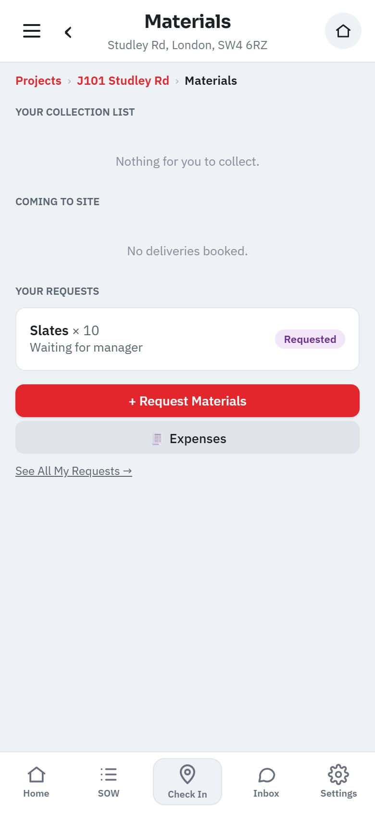
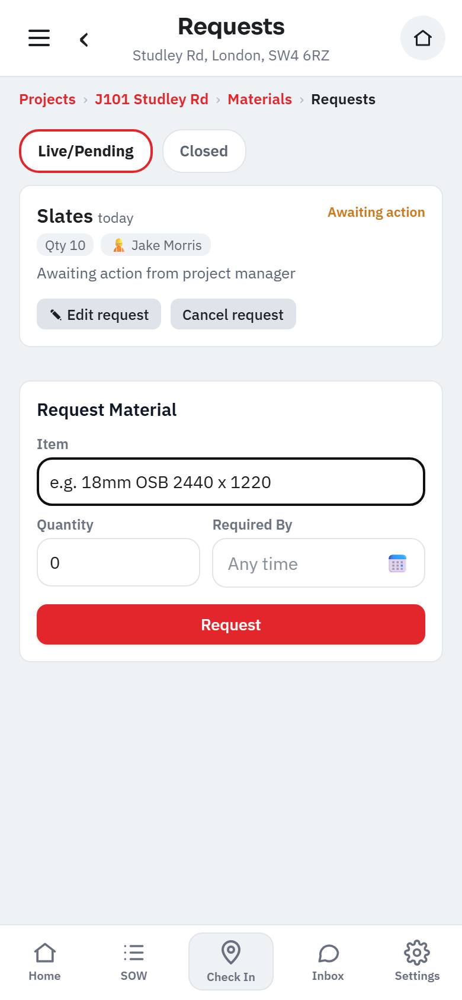

## O14. Drawings

**What it's for:** the job's drawings, specs and programme.

1. Tap **Drawings, Spec's & Programme**.
2. Tap a folder to open it.
3. Tap a file to view it. Old versions are kept apart from the current ones.

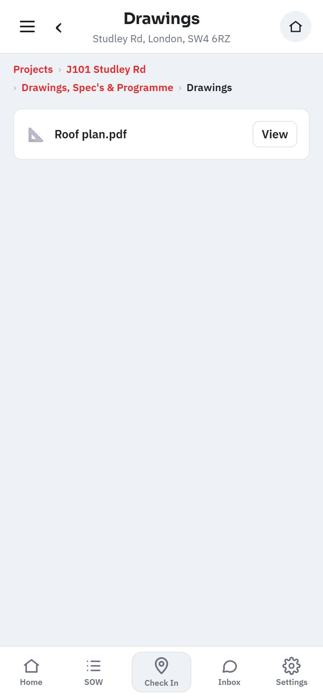

## O15. Messages and Inbox

**What it's for:** messages from the office and everything waiting for you.

1. On Home, tap **Messages & tasks**. Or tap **Inbox** in the bottom bar on your projects list.
2. **To sign / do** lists everything waiting: RAMS, COSHH, talks and more. Tap one to go to it. **Outstanding** in the bottom bar opens this too.
3. **Messages** shows messages from your jobs. Opening the tab marks them read.
4. **Company Chat** is one chat for the whole company.
5. Inside a job, tap **Inbox** in the bottom bar for that job's messages. Write a reply and tap **Send Reply**.

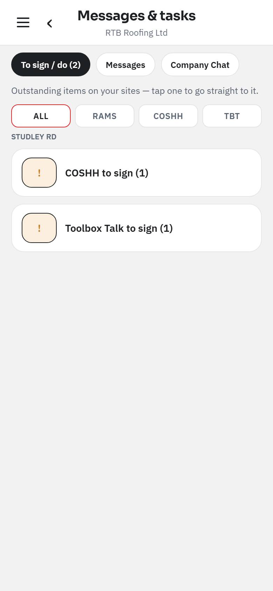

## O16. Expenses

**What it's for:** sending receipts to the office.

1. Tap **Materials**, then **🧾 Expenses**. (Your manager decides if it shows on a job.)
2. Tap **📷 Take photo**, **🖼 Photos** or **📎 PDF**.
3. Check **Which job is this for?** Tap it to pick another job, or type a **Job name / address**. Add a **Note (optional)**.
4. Tap **Save & send**. Sent ones are under **Sent receipts**. Tap **✉️ Resend** if needed.

Receipts are emailed to the address your company has set up.

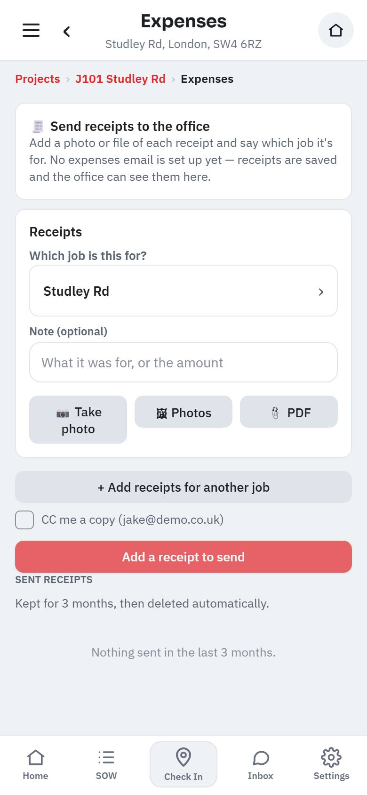

## O17. My Dashboard

**What it's for:** your certificates, your tools and what's outstanding.

1. Tap **My Dashboard** in the bottom bar, or **My dashboard** on Home.
2. Check your outstanding items at the top.
3. Under **Certifications**, add a certificate. Describe the type, add an **Expiry date (optional)**, and tap **Upload**.
4. **My Tools** lists your tools.
5. Tap **📄 Export all (PDF)** or **✉️ Email all** to send all your certificates as one PDF.

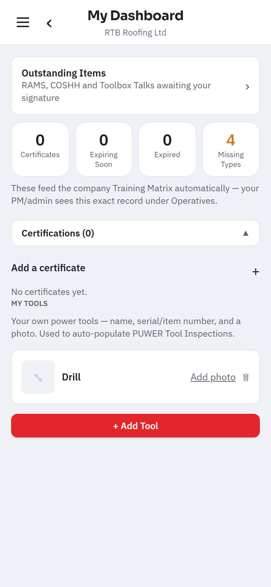

## O18. Settings and your signature

**What it's for:** your account, phone number and signature.

1. Tap **Settings** in the bottom bar.
2. Add your **Phone Number** and tap **Save Phone Number**. Drivers see it when you're the site contact.
3. Your signature is drawn once and used every time you sign. To redo it, tap **✍ My Signature**, draw it again and tap **Save Signature**.
4. Tap **📁 My Employee Record** for your details, policies and payslips.
5. Tap **💡 Show The How-To Tips Again** to see the tips.
6. Tap **Sign Out** when you're done.

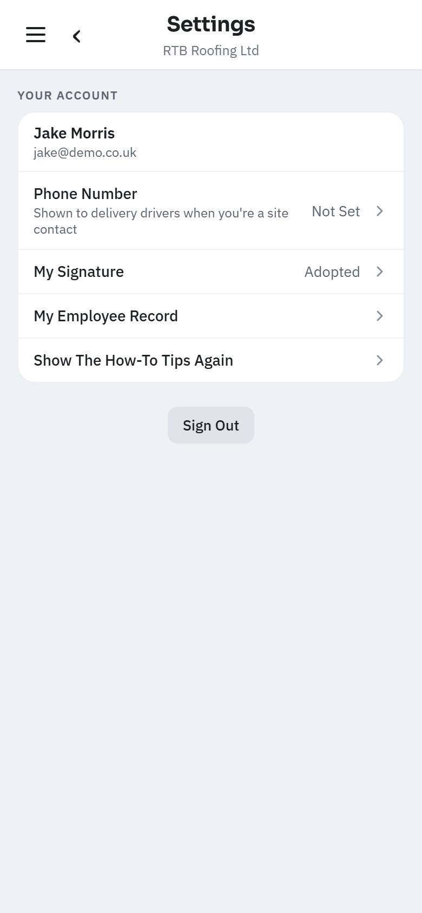

---

# Part 3: Projects as a project manager

PMs use the phone on site and the laptop in the office. Everything below works on both.

## P1. Your Home page

**What it's for:** your day at a glance.

1. The top shows **Live projects**, **On site now** (or **Due In**), **To do** (or **Quotes To Price**) and **Notifications**. Tap one to open it.
2. A **Needs you** card shows invoices and wages the office has sent you to book.
3. Tap the red **Live projects** card for your jobs.
4. Below are **Today** and the next five working days. Tap a day to add to it.
5. Tiles: **OpHUB Finance** (if you have it), **Quotes**, **Dashboards**, **Reports & Surveys**, **HR** and **Admin**.

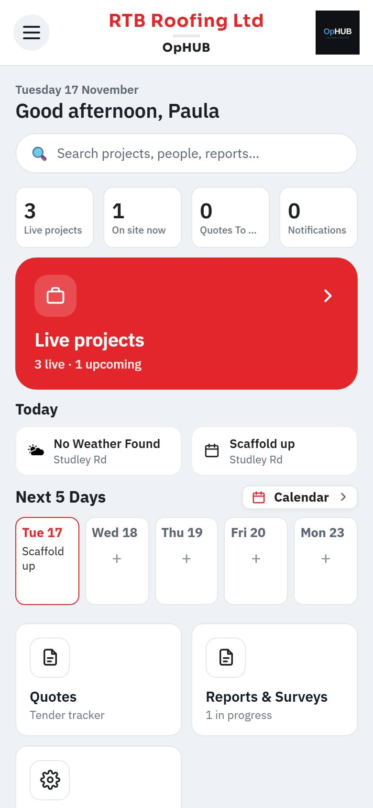

## P2. Making a project

**What it's for:** setting up a new job.

1. Tap the red **+** in the bottom bar on the projects list.
2. Fill in **Site name \***, **Address \***, **Postcode** and **Job number**.
3. Type the **Client \***. Clients from the Directory come up as you type.
4. Add **Client number** and **Client email**.
5. Tick **Multi-site job** or **Repair / maintenance contract** if it is one. Tick **Create OneDrive folder** to make its folders.
6. Choose **Active** or **Upcoming** and the **Start date \***. Tap **Create Project**.

**What This Does In Finance:** the job appears in Finance › Projects, ready for its Finance page. With automatic numbering on in Finance, it gets the next job number.

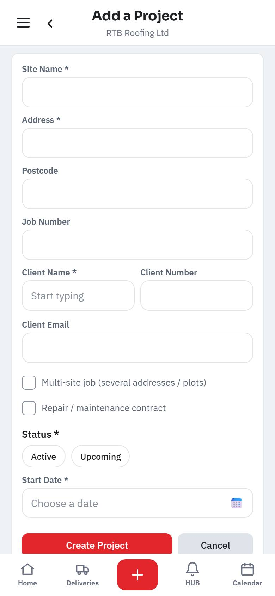

## P3. Site location and check-in area

**What it's for:** where operatives must be to check in, and how close.

1. Open the job. Tap **Check In** in the bottom bar.
2. Scroll to **Site Geofence**. Tap **Set Site Location**.
3. Choose **Click for GPS Co-Ordinates — use this device's location** if you're stood on site.
4. Or choose **Input GPS Co-Ordinates — type in latitude & longitude**. You can paste a pair from Google Maps. Tap **Save Location**.
5. Pick the distance in the drop-down. Tap **Save**.
6. It now reads **Set · Check-ins within** that distance. Tap it to change it. The red bin removes it.

Managers check in without GPS. Below the geofence you'll see **Site Team — Live Status**. On a multi-site job, each address has its own location.

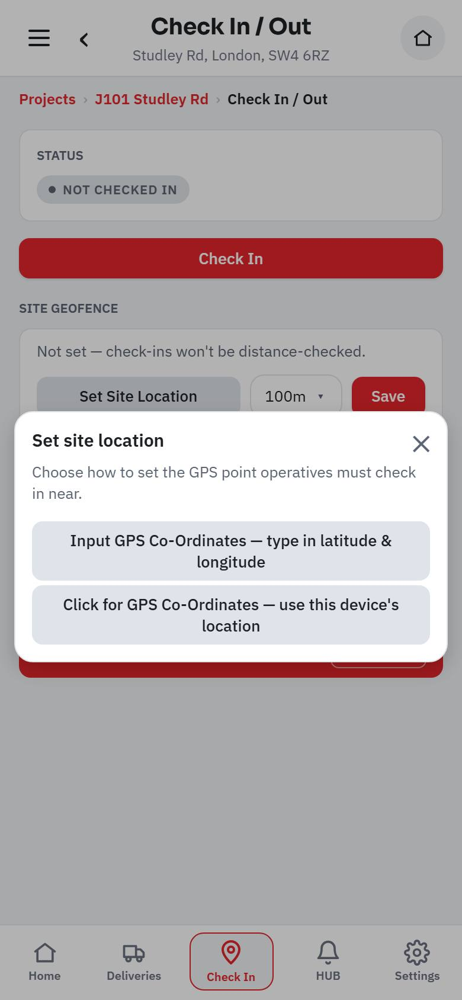

## P4. Putting the team on a job

**What it's for:** operatives only see, and check in to, jobs they're assigned to.

1. Open the job. Tap **Settings** in the bottom bar (or the gear at the top right).
2. Tap **👥 Team — operatives, site managers & clients**.
3. Tap **Assign Operatives to Project**. Tap each name to add or remove them.
4. Use **Assign Site Managers** and **Assign Clients** the same way.

A new live job with nobody on it shows a yellow card on its home page. Tap it to assign people there.

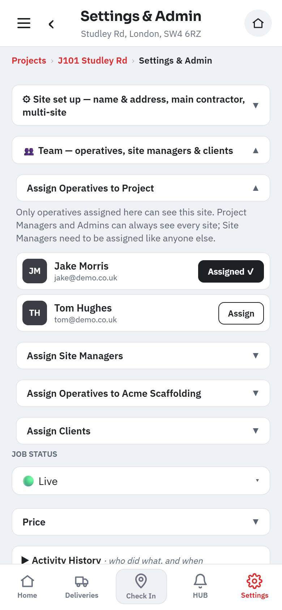

## P5. Project Settings

**What it's for:** the job's set-up, status and switches.

1. Open the job. Tap **Settings** in the bottom bar.
2. **⚙ Site set up**: change name, address and job number. Switch **Main Contractor**, **Multi-Site** (and its addresses) or **Maintenance / Repair Contract**.
3. **Job Status**: **🟢 Live**, **🗓 Upcoming** or **🔒 Closed**.
4. **Price**: tick **This project is on a price** to add the Price row.
5. **☁️ OneDrive sync folder**: link or unlink the job's folder.
6. **▶ Activity History** shows who did what, and when.

**What This Does In Finance:** a closed job drops out of Finance's job pickers for new invoices, POs and yard stock.

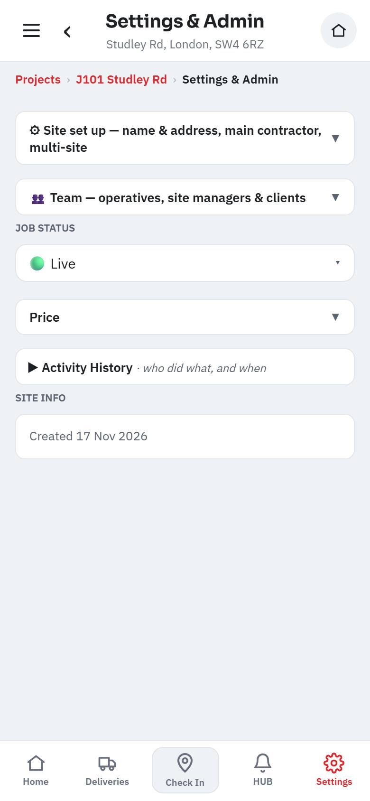

## P6. Client info and client POs

**What it's for:** the client contact, and the client's purchase orders.

1. On the job's home page, tap the client box at the top.
2. Check the client details. Edit them if you need to.
3. Tap **+ Add Client PO**. Add the number, date and files.

**What This Does In Finance:** the client PO shows in Finance › Project Admin and goes on invoices. If Finance set the client up, it can only be changed in Finance.

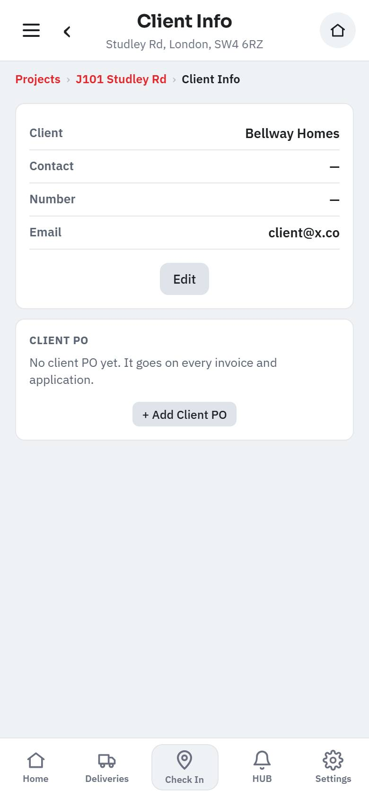

## P7. Schedule of Works

**What it's for:** building the task list operatives work through.

1. Open **Schedule of Works**. Tap **+ Add Task** for a single task.
2. Tap **+ Section ▾** for more. Choose **📁 Add Section** (new, or **📚 From the library**), **📊 Import schedule (Excel, CSV or PDF)** or **📐 Add Variation**.
3. Use each task's **⋯** to edit, move, link an address, or choose **🔒 Who Can See This**.
4. To finish a task without new photos, tick photos already there and tap **✓ Mark complete with**.
5. Use **☑ Select Multiple** to delete several at once.

**What This Does In Finance:** Finance can send its Bill of Quantities to this schedule. Your team's progress then feeds the application for payment.

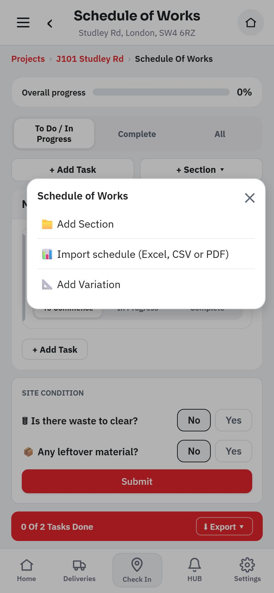

## P8. RAMS

**What it's for:** building or uploading RAMS, and getting them signed.

1. Open **Health & Safety**, then **RAMS**.
2. Open **Create / Upload RAMS**. Tap **🦺 Create RAMS** or **📄 Upload RAMS**.
3. To build one, tap **+ Start new RAMS**. Name it. Start from a template, or copy another job's.
4. Tap **Create RAMS**. Work through the tabs: **Info**, **RA**, **SSOW**, **MS**, **Issue**.
5. On **Issue**, tap **✓ Issue Risk Assessment & Method Statement**.
6. Tap **🔔 Ask Outstanding To Sign** to remind anyone who hasn't signed.

Use **👁 Preview RA** and **👁 Preview MS** to check before you issue.

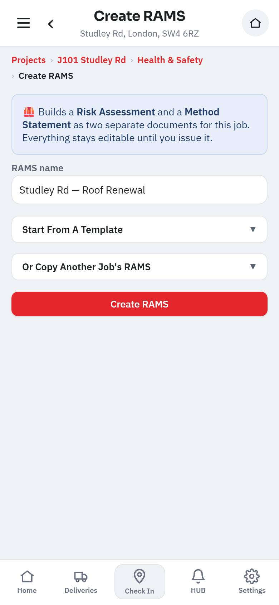

## P9. COSHH

**What it's for:** adding COSHH assessments for the team to sign.

1. Open **Health & Safety**, then **COSHH**.
2. Tap **Create COSHH**. Choose **Add From Library**, **Create COSHH** or **Upload COSHH Assessment**.
3. **Add From Library:** tick the documents, then tap **Add**.
4. **Create COSHH:** upload a data sheet, or enter the product by hand.
5. Tick what to issue and tap **Issue**. Each product becomes its own COSHH sheet to sign.

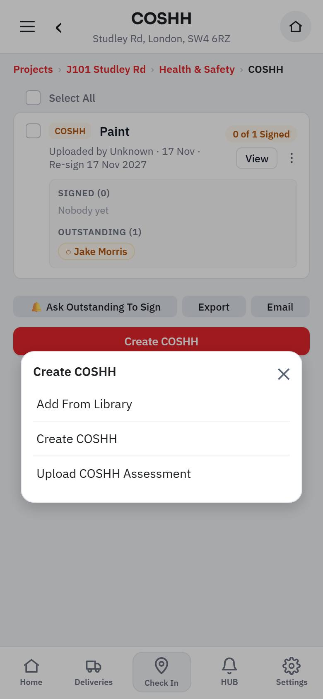

## P10. Toolbox talks and daily briefings

**What it's for:** giving talks and briefings and getting them signed.

1. **TBT:** open **Health & Safety**, then **TBT**. Use **Upload A Toolbox Talk** or **Write A Toolbox Talk**.
2. Open a talk. Tap **✍ Issue for Signing**. Later, use **✓ Mark as Completed**.
3. **Briefings:** open **Daily Briefings**. Tap **+ New Briefing**.
4. Fill it in. Tap **Complete Briefing**, then **Issue For Signing**.

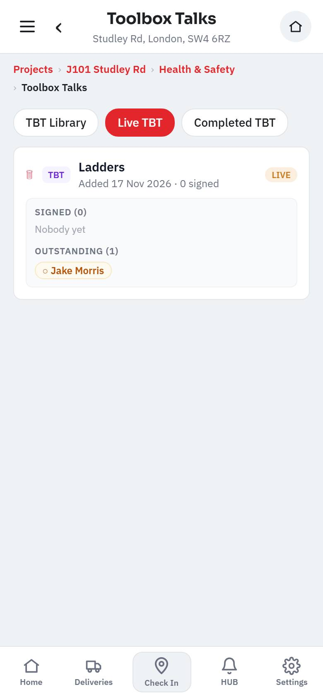

## P11. Permits, inductions and inspections

**What it's for:** main contractor paperwork. Switch it on in Project Settings › **Main Contractor**.

1. Tap **Main Contractor** on the job.
2. **Permits To Work:** tap **+ Issue Permit**. Choose the type, contractor, who must sign, description and date. Tap **Issue Permit**.
3. To finish, open the permit and tap **Close Permit**. Hot works needs two fire-extinguisher photos.
4. **Site Inductions:** see who's done and who's outstanding.
5. **Inspections:** tap **Start** on a template.

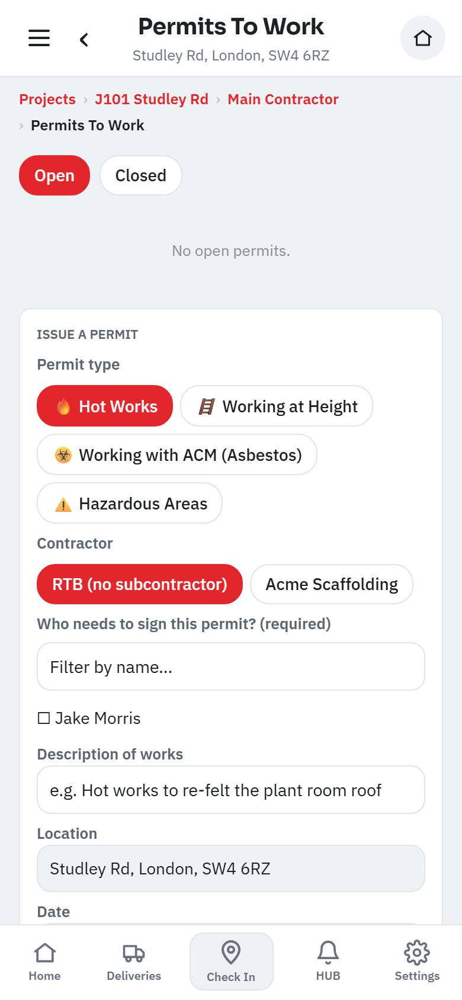

## P12. Incidents, HAVS and PPE

**What it's for:** keeping an eye on site safety records.

1. **Health & Safety › Accident / Incident**: read reports filed on the job.
2. **Tools, HAVS & PUWER**: see HAVS and tool checks. Use the tile's **⋮** to choose who sees it.
3. **PPE**: tap **+ Issue PPE**, or **Fulfil** a request.

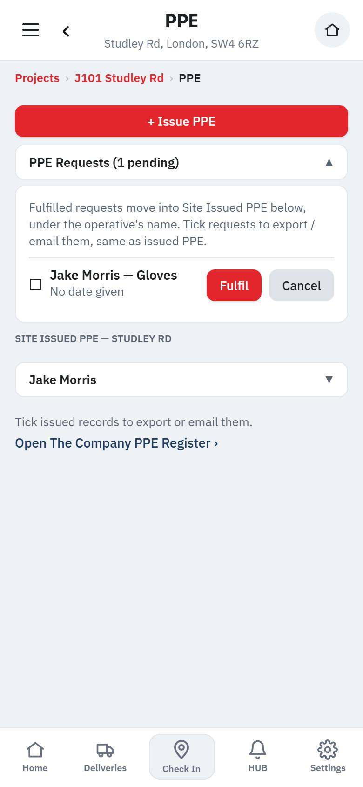

## P13. Materials and orders

**What it's for:** turning requests into orders.

1. Open **Materials**, then **Requests**.
2. On a request, tap **🚚 Order from Merchant**.
3. Choose **Delivery**: **🚚 Deliver to site**, **🚐 Driver collection** or **👷 Operative collection**.
4. Pick the **Supplier** (★ favourites first) and **Branch**. Set the date. Add a note.
5. Tap **Confirm & send to** the supplier.
6. Or use **🏗 Yard Stock**, **📦 Add to collections** or **Close Request**.

**What This Does In Finance:** if you have Finance, and **Raise a PO for every PM's order** is on, sending raises a PO in Finance › Purchases. Once sent, the order is locked here: changes are made in Finance. Stock from the yard is costed to the job.

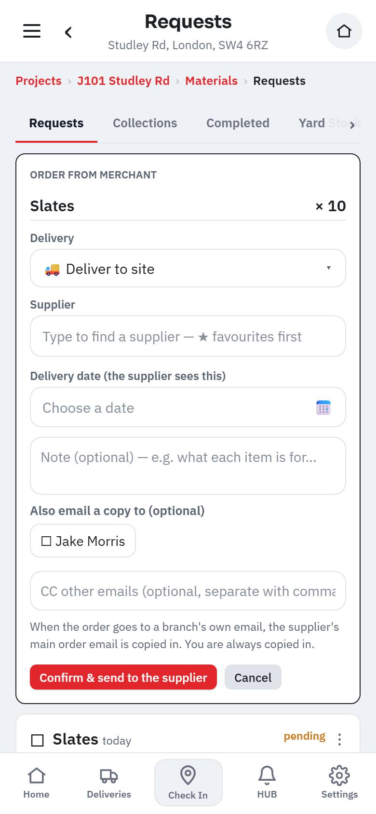

## P14. Material PO's and plant hire

**What it's for:** the job's orders, without prices, and hired plant.

1. Open **Materials**, then **Material PO's**.
2. Tap **Change ▾** on a PO to change the delivery date or note, or cancel it.
3. Orders the office raised show under **Ordered By The Office** on Materials.
4. Open **Plant**. Tap **+ Plant On Hire**. Fill in what, supplier, ref and dates.
5. Tap **Off Hire** when it goes back.

**What This Does In Finance:** plant you put on hire appears in Finance › Plant Hire for Finance to add the rate.

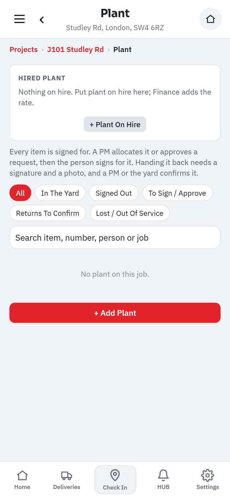

## P15. Subcontract orders

**What it's for:** recording who's doing what labour on the job.

1. Tap **Subcontract Orders** on the job. (Or **Materials › Subcontract Orders** if the job isn't on a price.)
2. Tap **+ New Subcontract Order**.
3. Pick from your subcontractors, or type the **Subcontractor** and **Email**.
4. Fill in **Scope Of Works** and **Notes**. Save.

**What This Does In Finance:** the order lands in Finance › Subcontractor POs. It shows **Finance To Add The Value** until Finance adds the value, CIS and retention.

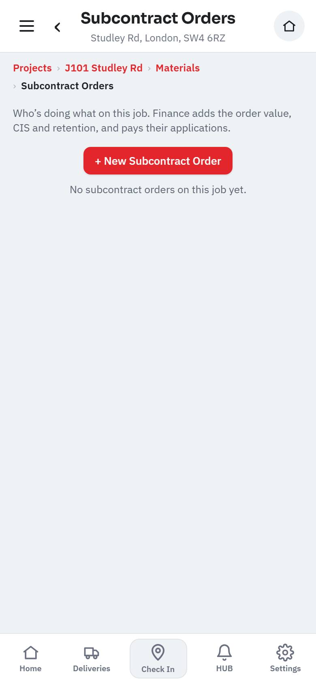

## P16. Deliveries

**What it's for:** the drivers' day, drop by drop.

1. Tap **Deliveries** in the bottom bar.
2. **To schedule** lists waste and leftovers flagged on site. Tap **Schedule** to book one.
3. Tap **+ Add Delivery**. Choose the site, what's needed, where from, date, drop and driver.
4. Use ▲▼ to reorder drops.
5. **👁 Driver view**, **🚐 Vehicle health checks** and **🏗 Yard & Plant** are on this page too.

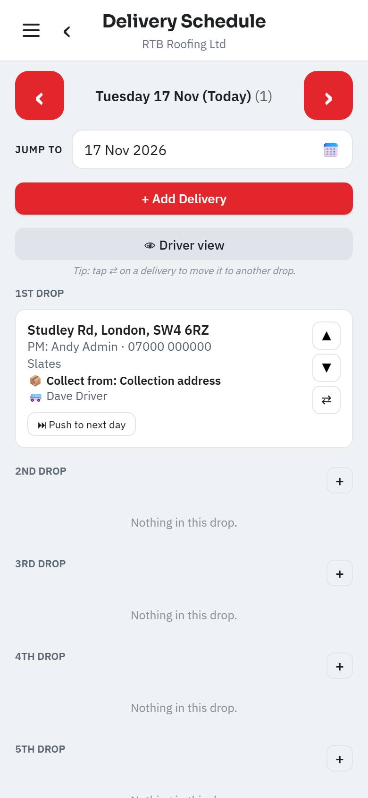

## P17. Drawings and documents

**What it's for:** the job's drawings and its OneDrive folder.

1. Open **Drawings, Spec's & Programme**.
2. Tap the **+** menu: **📁 Add Folder** or **📄 Upload a file**. A job with a OneDrive folder also has **☁️ Sync from OneDrive**.
3. Use a folder's menu for **🔒 Who Can See This**.
4. After uploading a programme, the app offers to add a key date to the Calendar.
5. If the job has a OneDrive folder, a **Documents** row shows it as it is in OneDrive.

**What This Does In Finance:** Finance's **Documents** tab on the job shows the same OneDrive folder.

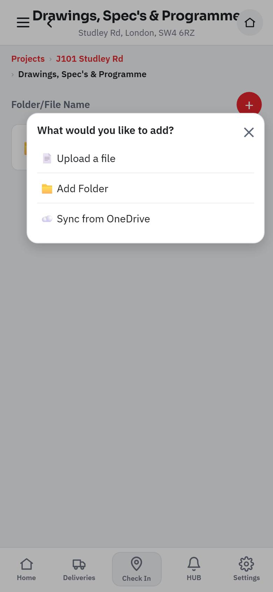

## P18. Calendar

**What it's for:** key dates for one job, or every job.

1. Tap **Calendar** in the bottom bar for every job. Filter by PM or site.
2. Inside a job, open **Calendar** for that job only.
3. Tap **＋ Add a key date** (job) or **+ Add To Calendar** (all jobs).
4. You can make a date private, repeat it, or add a reminder. Tick **🚚 Also Add to Delivery Schedule** if it's a delivery.

**What This Does In Finance:** Finance's application dates show as **💷 Application due**. Delivery dates on Finance POs show too.

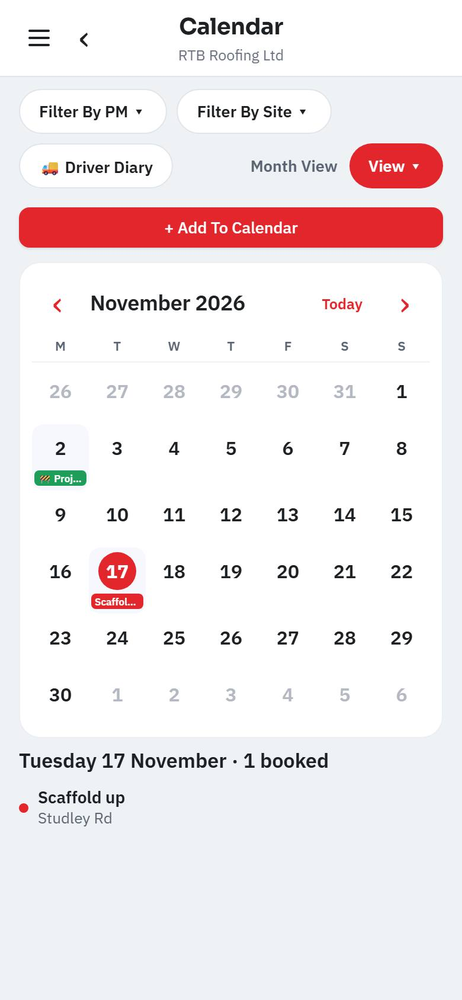

## P19. The HUB and To Book

**What it's for:** everything waiting for you, in one place.

1. Tap **HUB** in the bottom bar.
2. Tabs: **To Do**, **Projects**, **Finance**, **Company Chat** and **All**.
3. Filter by site, due date and whose jobs.
4. Tap a row to go straight to it. It drops off once it's dealt with.
5. Tap **+ Add A To Do** to add your own.

**What This Does In Finance:** the **Finance** tab shows invoice queries from the office, invoices to book and wages to book. Tap a query to answer it. The **Needs you** card on Home opens **To Book**: tap **Book to this job** or **Send back**. (Finance doesn't send invoices or wages to PMs to book while it's on trial.)

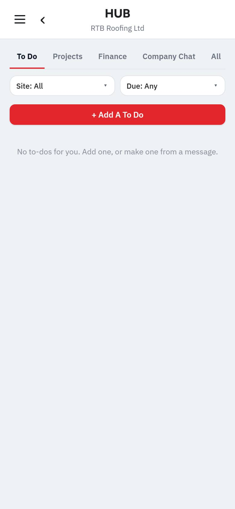

## P20. Reports and surveys

**What it's for:** reports across all jobs, and surveys with no job.

1. Tap the **Reports & Surveys** tile on Home.
2. Tap **Start a report**. Pick a job, or **General survey — not linked to a project**.
3. Fill it in. Add photos and notes.
4. Tick finished reports. Tap **Export PDF** or **Email**.

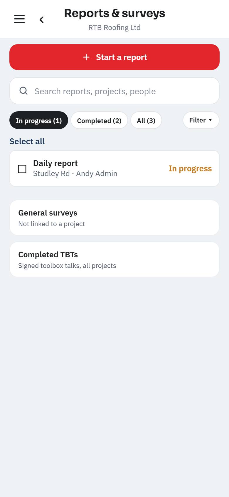

## P21. Snags, day works and inspections

**What it's for:** the job's snags, day works and inspection reports.

1. Open **Inspections & Reports** on the job.
2. **Snagging:** tap **+ Add Snag**. Fill in **Issue \*** and **Location**, and tap **📷 Add Photos**. Tap **🏷 Tag Someone** if someone needs to know. Snags are closed as operatives do.
3. **Day Works:** record the date, work, sheet number, labour, plant and materials. Attach the signed sheet.
4. Take it through the client with **Client ▾**.
5. **Reports:** tap **+ New Report**, choose a template, tap **Start**.

**What This Does In Finance:** day works go into Finance's day works by themselves. Finance adds the value.

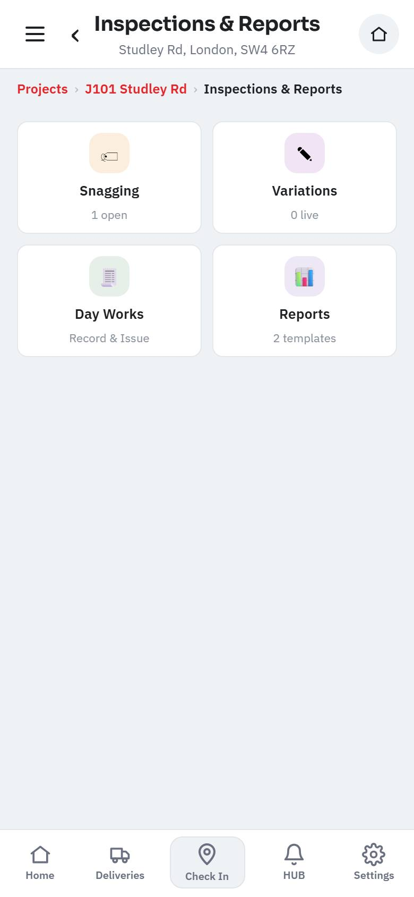

## P22. Variations

**What it's for:** approving variations and taking them to the client.

1. Open **Inspections & Reports**, then **Variations**. Tap one to open it.
2. Tap **Approve**, **Decline** or **Modify Then Approve**. Add a value with **Save Value**.
3. Tap **Client ▾**. Choose **Issued To Client**, then **Client Approved…** or **Client Rejected**.
4. Tap **Add To Schedule Of Works** for the team to do it.
5. Tap **Close Variation** when done.

**What This Does In Finance:** variations come into Finance's register by themselves, with your value. Only **Client Approved** ones go on an application.

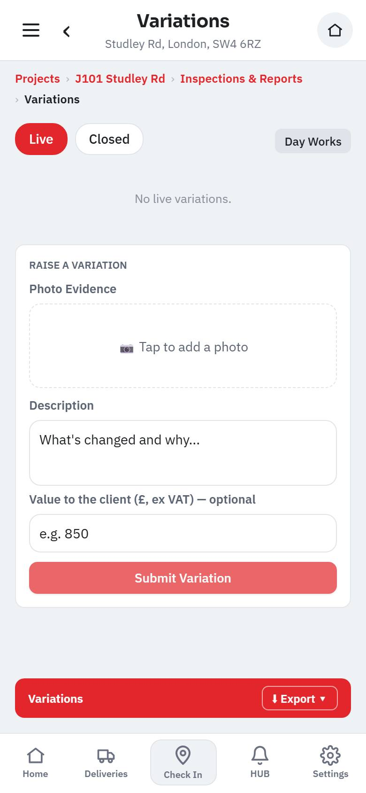

## P23. The Price tile

**What it's for:** a job on a price: what each part is worth, and what's been booked against it.

1. Turn it on in Project Settings › **Price**.
2. Tap **Price** on the job. Each tile shows price, booked in and balance.
3. Tap **+ Add price** to add one. Open a price to book weeks in. Tap **💾 Save**.
4. Tap **Price Sheets**, then **+ New Sheet**. Tick items from the rate card, tap **Next — enter quantities**, then **Issue**.

**What This Does In Finance:** wages and operative invoices sent by Finance show as **wages to book** here. Finance can also put a subcontractor PO into the Price tile as an issued price sheet. (Sending wages is off while Finance is on trial.)

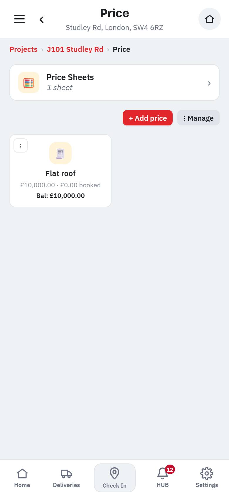

## P24. Handover (O&M)

**What it's for:** the O&M manual, data sheets and guarantees at the end of a job.

1. Set the job to **🔒 Closed**. The **Handover** row appears.
2. Under **Practical Completion**, tap **Set**. Add the date and **Defects Period (Months)**.
3. Tap **+ New O&M Manual**. Fill in the cover and **Scope Of Works**.
4. Add to the back: data sheets, guarantees, reports or files.
5. Tap **📄 Download PDF**, **📝 Download Word** or **✉ Email PDF**.

**What This Does In Finance:** Finance uses the practical completion date and defects period for the retention release dates.

## P25. Quotes

**What it's for:** tracking tenders from enquiry to win.

1. Tap the **Quotes** tile on Home.
2. Tap **+ New Enquiry**. Fill in the client and project.
3. Move it along the status bar as you price it. Tap **📨 Submit Quotation** when it goes out.
4. Won it? Tap **🏆 Won – Convert To Project**. The new project form is filled in for you.

## P26. Dashboards

**What it's for:** the big picture across the company.

1. Tap the **Dashboards** tile on Home.
2. Choose **Company Dashboard**, **Operative Dashboard** or **Deliveries**.
3. Tap a number to see the jobs behind it.

**What This Does In Finance:** people with Finance also see a **Money** section on the Company Dashboard.

## P27. Admin: users, invites and phones

**What it's for:** your team's accounts.

1. Tap the **Admin** tile on Home.
2. **People › Invites:** tap **Generate One-Time Invite Link** or **Send Invite Email**.
3. **People › Users:** tap a person to change their role or phone, or remove them.
4. **People › Device Locks:** **Approve** or **Deny** a new phone. **Unlock** a phone.

**What This Does In Finance:** an admin with Finance switches **Finance** on or off on each person's row in Users.

## P28. Admin › Roles › What Each Role Can Do

**What it's for:** deciding what each office role can use. Company admins only.

1. Open **Admin › People › Roles**.
2. Tap a role to rename it or change **Uses The App As**. Tap **+ Add A Role** for a new one.
3. Scroll to **What Each Role Can Do** and choose a role from **Role ▾**. Only that role shows.
4. **Options** on the left are the parts it hasn't got. **In This Role** on the right are the parts it has.
5. Tap a part with **→** to add it, or one with **←** to take it out. It saves straight away.

The parts are: **Every Job**, **Create Projects**, **See Prices**, **Finance – View**, **Finance – Edit**, **Quotes And Price Builder**, **Schedule Of Works**, **Snags And Variations**, **Sign Off H&S**, **Raise Orders**, **Drawings And Documents**, **Team And Calendar**, **Manage People**, **Reports** and **Notifications And Emails**.

**What This Does In Finance:** without **Finance – Edit**, Finance shows **View Only**. Without **Raise Orders**, **+ New** has no purchase or subcontractor orders.

